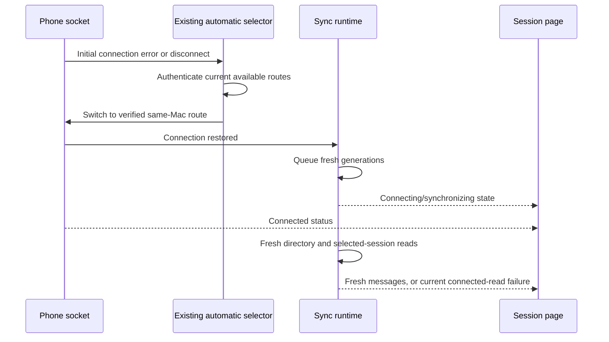

# Cold connection recovery after service pause

## Evidence

The user initially confirmed Mac Pause/Start and phone title-cache usability,
then reported a persistent session synchronization error. Publication of 0.5.7
was withheld even though its Mac notarization had been accepted.

A genuine phone diagnostic with explicit Auto selection subsequently established
realtime in 17.7 s, read the catalog in 401 ms and fresh recent rows in 269 ms,
with both reads returning 200 and the original native state active. Two LAN
entries were unreachable; a newly authenticated LAN entry was reachable. This
demonstrates a working current original-owner read after route restoration.

## Recovery gaps and changes

- Cold startup against a stored obsolete endpoint emits `connect_error` without
  first emitting disconnect. Automatic selection previously handled disconnect
  only; it now handles the error entry too and keeps the existing in-flight guard.
- Socket.IO already renewed its one-use sealed device proof per retry. The retry
  did not leave the old error status, so repeated errors were deduplicated. Each
  retry now enters connecting before its next connection attempt, using the
  existing Socket.IO backoff and cancellation ownership.
- Both the source banner and body loading overlay show synchronization while a
  route is recovering. A confirmed current read failure on a connected route
  still offers Retry. Before publishing connected status, Sync queues fresh
  directory and visible-session generations so an old failure cannot flash back.
- Desktop selection uses the authenticated peer identity during same-Mac route
  changes. A different peer is rejected; legacy connections retain their original
  endpoint fence. Selection journals and unknown operation IDs stay unchanged.

62 targeted mobile regressions passed, including cold error recovery, coalesced
selection, repeated reconnect status/proof handling, both loading surfaces,
same-peer versus different-peer selection and queued visible-session generations.
All bridge/mobile/relay typechecks and bridge lint passed. The later native 116
acceptance and public 0.5.8 checks are recorded in
[the release verification](../2026-11-02/release-0.5.8.md).
