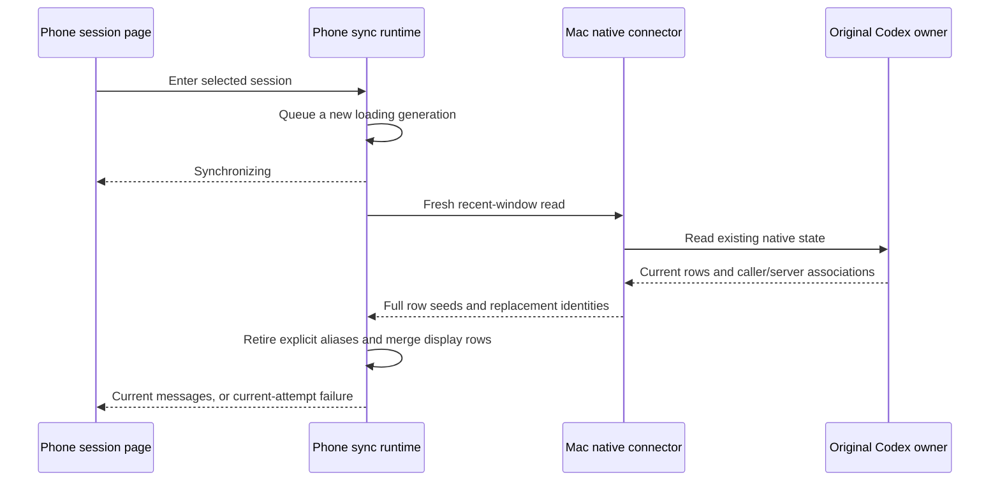

# Fresh session synchronization and native input identity

## Observed failures

The phone could render an old disconnected state with Retry before the new
selected-session read had started. Selection initially used a failed default,
and message progress did not own a generation until the asynchronous fetch ran.
The old metadata therefore appeared to describe the new attempt.

A Mac-authored user input also appeared twice on the phone. The original owner
associated a temporary steering item and the accepted user item through the
same caller/server identities. The connector had published the temporary UUID
and accepted ID as two native rows. Their equal text was corroborating evidence;
the original identity association is the basis for the repair.

## State ownership and changes

- Session entry queues loading before waiting for the read. The fetch reuses
  that generation; older completions and failures cannot finish a newer entry.
- The source banner ignores cached disconnected state during current loading.
  Retry starts a fresh read and repeats desktop selection only when selection
  itself failed.
- Native steering placeholders use a stable caller identity. The adapter carries
  the temporary native IDs that the original owner explicitly replaced.
- The connector publishes an upsert when replacement metadata changes even if
  the text did not change. It retains retired wire aliases in fresh row seeds.
- The phone retires those aliases independently of content-version checks.
  An equal/older-version wire update can clean up aliases without overwriting a
  newer snapshot. Unrelated equal-text inputs remain separate.

## Verification and local build

71 scoped adapter/connector tests and 75 scoped mobile compatibility, reducer,
preload, banner and loading tests passed. All bridge/mobile/relay typechecks and
bridge lint passed on the final source; `git diff --check` passed.

The Mac 0.5.6 bundle was rebuilt independently from current source and matched
the installed candidate. Mac and phone 2026110114 strict signature verification
passed. Both were installed locally. The complete stopped connector and old
app were retained. Local health returned 200, and Mac box/relay/network identity
files and the account secret matched the pre-install state. The original desktop
process remained unchanged. Notarization and public publication remain deferred.

The user entered this chat from the phone session list and reported that the
fresh synchronization state, latest messages, header/input-area layout and first
question submission were normal, with no submit error and automatic form close.
The phone journal recorded dispatch to confirmed completion in 471 ms, removed
the new pending operation, and matched both a complete acknowledged Mac receipt
and an accepted original-owner input carrying the same command ID.

A fresh read of the actual original owner also returned the legacy steering
UUID and stable pending caller identity as replacement aliases of the accepted
row. Existing historical encrypted journal records remain preserved; current
row seeds carry the association when that older row is read. The targeted
reducer regressions verify their display merge and reject late retired rows.
The user's physical message check covered the latest window. Historical unknown
operations retain their original IDs and are not replayed.

The automatic diagnostic route did not save a new report during this install;
the old stored report is not counted as a new-build result. This phone submission
verifies the active route used by the phone, not every alternative channel.
