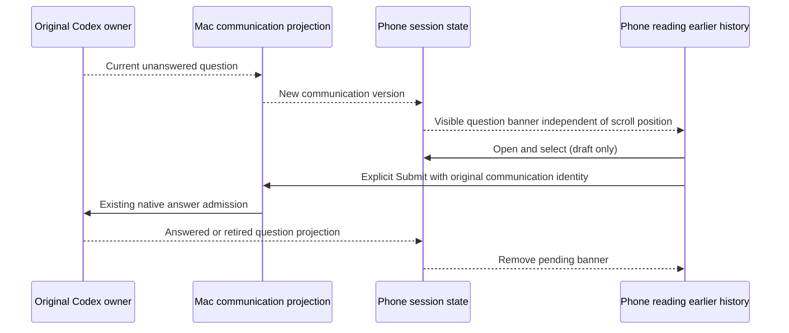

# Pending question visibility while reading history

## Confirmed cause and fix

The portrait phone session uses a floating input dock. Reading earlier messages
sets `isChatAtBottom=false`, which hides auxiliary status through `AnimatedFade`.
The pending-question banner previously shared that wrapper. `AnimatedFade` then
sets opacity to zero and `pointerEvents="none"`: a new communication could reach
the phone state while its only question entry remained invisible and untappable.

The question banner now keeps its existing centered layout outside this optional
status fade. It continues to use the same communication selector, native question
identity and answer transport. Other dock status rows and the existing composer
retain their scroll behavior. This is a confirmed conditional visibility bug;
the user's particular missing question has not been attributed to this condition
through a captured physical-phone trace.

## Executed regressions

- The new `SessionQuestionDock.test.ts` executes the actual `SessionViewLoaded`
  input JSX in a lightweight React harness. Before the fix, a late communication
  while reading history failed because a banner ancestor had `pointerEvents=none`.
- After the fix, the test verifies visibility, opening the real modal, selecting
  Beta without submission, submitting the original form identity once, question
  retirement, retained composer instance, and continued auxiliary status fading.
- 36 tests passed across `SessionQuestionDock.test.ts`,
  `AgentQuestionFallback.test.ts`, `agentCommunications.spec.ts`, and
  `pendingCommunicationsSelector.spec.ts`.
- `pnpm typecheck:mobile` and `git diff --check` passed.

The harness uses the existing modal and selector with mocked native widgets and
transport. It does not establish physical-phone appearance or live Codex answer
delivery.

## Native scene and remaining acceptance

Open `codelight://dev/agent-question?history=1` on the candidate native build.
The scene contains 40 sample earlier messages with a fixed pending-question
banner outside the scroll area. Scroll in both directions, open the banner,
select options and close the form. `&open=1` opens the sheet directly. Do not
submit the preview's `demo-session` fixture to a real native owner.

Then verify a real current question while the phone is scrolled away from the
latest message. Confirm its banner and options remain visible, explicitly submit
once, and verify the matching original desktop reply and subsequent banner
removal. Native scene, physical-phone and live delivery results are to be appended
after those checks; they are not claimed by the regressions above.

## Native follow-up

iPhone Release build `2026110102` was installed and launched successfully. The
same source's dedicated native simulator build showed the prompt while the
earlier messages were visible. The prompt opened the answer sheet; single-choice
and multiple-choice selections were reflected in the native accessibility state,
and the explicit submit control became enabled. No preview answer was sent.
Screenshots and accessibility observations are retained in the task evidence.
The user subsequently selected the owned network Relay. Native server/key
validation, saved configuration and actual public Mac health passed; the fresh
QR is displayed for reconnection. The originally reported physical-phone prompt
and its live reply remain awaiting user verification on that connection.
