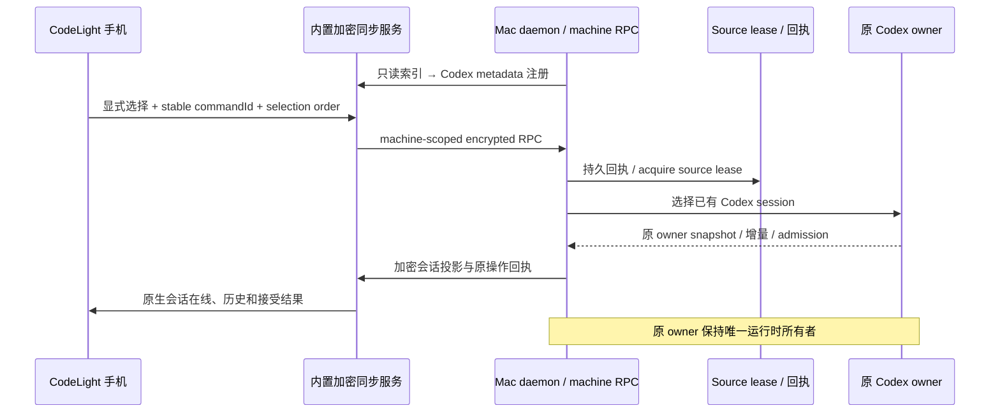

# CodeLight Mac 的 Codex 发现与配对

2026-10-31 当前发行只发现和控制 Codex 的原生会话。其他 harness、窗口库存和 AX 控制属于保留的延期研究，参见 [当前产品合同](codelight-product.md)。

## 入口与数据所有者

- 正常入口是 CodeLight Mac App：它启动自身的内置加密 API、Connector 和出站隧道，显示手机扫码所需的临时邀请。正常手机流程不要求服务器选择、账号注册或 VPN，详见 [一次扫码合同](codelight-one-scan.md)。
- `node scripts/codelight-daemon.mjs` 是高级自建服务/诊断入口。它接受显式 `--server=https://your-server`、`--profile=/private/profile` 和可选 `--only=codex:native-id`；`--inspect` 只做发现检查。该入口保持与发行 App 相同的 Codex-only 范围，不启动 model runner。
- Mac App 的数据库、配对身份、设备注册表、source binding、观察检查点和回执保存在独立 application-support 目录；高级 CLI profile 默认位于 `~/.codelight`。这些状态不写入原 Codex 配置。
- 服务内部固定 loopback origin 是本地数据库和回执的身份边界；临时公网隧道地址只用于手机传输。切换服务器/账号不能把旧凭据发送到新 origin。
- 配对初始化和运行 profile 均持独占 lease，账号 fingerprint 与服务器身份一起验证。重复启动拒绝第二个 daemon，不能覆盖现有配对或生成第二个 native writer。

## 发现与激活

- 原 Codex 持久化索引只读提供会话标题、时间、父/子会话、项目归属、路径和置顶信息。source 身份保留 `(app, hostId, nativeId)`，工作路径只用于展示和文件定位。
- 当前发行注册和恢复 Codex 原生 session 描述符。其他 harness 或旧 window-mode 记录不能因已存在于 profile 就重新激活；窗口 ID、截图和 AX 控件不计为 Codex 会话支持。
- 默认 `LocalSourceDiscovery` 只读 Codex 索引，不扫描本地窗口；窗口研究只能由代码显式传入 `allowDeferredSources=true`，产品 CLI 不开放该开关。`--only` 的非 Codex 或空身份在读取 profile、配对或写入之前拒绝。
- `isCodeLightCodexSource(source,metadata?)` 是共享产品来源判断：`app='codex'`、`kind` 不是 `window`，control mode 为 `session` 或缺失。显式 window、null 或未知 mode 不能被旧记录恢复为原生会话；该判断不代替 owner/lease/native admission 校验。
- 一个 machine-scoped socket 提供 CodeLight presence、会话选择/观察与回执 RPC，不提供新建 Agent、任意 shell 或文件写入入口。
- source metadata 的 `bridge.controller='machine'`、`bridge.sourceKey` 与 `machineId` 引导手机通过 machine RPC 激活；原生 session ID 与加密同步记录 ID 分开。
- `codelight-select-source` 处理用户显式切换，保留 command ID 和每台手机的递增选择顺序；先持 source lease，再请求原 App 切换，历史同步异步开始。旧请求不能覆盖更新的选择。
- `codelight-observe-source` 只恢复被选中会话的观察，不请求桌面导航。`codelight-open-source` 保留原回执语义；重复回执查询不触发第二次操作。
- 每个 active source 一条持久 source lease。后台发现只扫描索引，不为全部 idle 历史创建完整会话订阅。恢复已激活 source 时只恢复观察与原 journal，不重放 desktop open、输入或未知动作。
- `codelight-close-source` 只关闭 CodeLight 观察、移除恢复标记并释放 lease；原 Codex 会话和 turn 仍由原 owner 运行。
- 未发现、lease 丢失、原 owner 不可用或原协议不兼容时保留明确不可用状态，不以 SDK resume 或窗口控制代替原会话协议。

## 索引目录可用状态

- `SourceRegistry` 为当前完整索引发现的 native metadata 发布
  `nativeSession.catalogueAvailable=true`。默认注册只接受当前产品来源；
  研究源码可以显式使用内部 `allowDeferredSources` 配置，不向产品 CLI 开放。
- 只有成功完成 Codex 索引扫描后确认条目不再出现，daemon 才调用
  `markUnavailable(binding,socket)`。索引失败不是条目删除，不能把一次失败
  解释为整个目录不可用。
- `markUnavailable` 通过 metadata CAS 只设置
  `nativeSession.catalogueAvailable=false`，保留 capabilities、原会话身份、
  控制设置、command/receipt 和历史记录，并持久保存该 source binding。
  CAS 版本冲突从服务端最新 metadata 重基，不覆盖并发原 owner 更新。
- 条目重新出现时 `refreshMetadata` 恢复 `catalogueAvailable=true`，沿用原
  source tag、加密 key 和同步记录 ID，不重新注册为另一个会话。该标志只
  表示索引目录可用性，不表示活跃、已停止或已删除原 Codex runtime。

## 项目状态

索引发现是标题、项目归属与 recency 的所有者；这些字段不是活跃状态。
手机前台项目统计使用独立的轻量原 Codex 状态投影，状态同步不能为计数
加载全部会话历史。版本、owner、未知/过期和断连边界以
[项目状态合同](codelight-project-activity.md) 为准。

## 验证

回归覆盖配对密钥和 origin 校验、同源激活单飞、重复 RPC called-once、
unknown 恢复不重放、source lease 冲突、Codex-only 发现/恢复、原索引失败隔离
和注册 ACK loss 保留原 DEK。项目状态、消息流和 UI 原生验收分别记录；
fixture 不发往真实工作会话，也不运行新模型测试输入。
