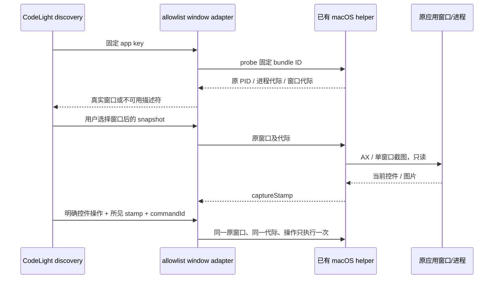

# CodeLight 本地 Coding Agent 窗口接入

> **延期研究（2026-10-31）**：当前 CodeLight 发行是 Codex 原生会话专用。本文件保留此前的窗口/AX 研究与验证边界，不表示当前已启用窗口共享或其他 harness。窗口 ID、截图与 AX 控件不计为 Codex session 支持；是否启用留待后续决定。当前范围以 [产品合同](codelight-product.md) 为准。

## 产品规则

2026-10-29 用户授权并行扩展更多本地 Coding Agent 的非侵入接入。已有应用、CLI 和会话由原进程拥有；CodeLight 只探测、读取以及转发用户明确的窗口操作，不创建 SDK runner，不修改原应用源码、包或配置，不自动启动或重启应用。

- 已安装与正在运行是不同事实。没有原进程时返回不可用占位，不能宣称 session 已连接。
- Coding IDE / Claude Desktop 使用公开 macOS AX + ScreenCaptureKit 的实际窗口。窗口 ID 不等于 session/turn ID；不按标题推断 CLI 或模型会话归属。
- 复用现有 native helper 的 PID、runtimeGeneration、windowGeneration、captureStamp、精确控件及剪贴板 CAS。新的 App 有各自截图目录与命令去重域。
- GUI 接入 allowlist：ZCode、Claude Desktop、Cursor、Antigravity、Windsurf、VS Code、Zed、Trae、Terminal、iTerm、Warp。未在 allowlist 的键拒绝创建 adapter；bundle ID 从产品目录固定，不接受 RPC 提供任意 bundle ID。
- 原生权限或窗口当前不可用时关闭操作能力。系统锁屏时清除图像和关闭控制；不根据空 AXWindows 推断锁屏。
- Terminal / iTerm / Warp 提供窗口观察与显式控件/按键操作；默认关闭 `type`。终端 AX 文本通常包含 scrollback，不能假设它是空的 Agent 草稿，更不能按可执行文件名将窗口绑定为某个 CLI session。
- Claude Code、OpenCode、Aider 的安装及精确可执行文件进程可只读列出；未证明原活跃 owner 的 API 时不提供 session-native 输入、停止或权限回应。SDK resume 不是接管另一进程。

## 接口

`inspectLocalAgents()` 返回安装、版本、原应用进程和 CLI 进程库存，不返回用户聊天内容或进程完整 argv。

`discoverLocalAgents({includeUnavailable})` 返回：

```ts
{
  app: string, id: 'window_<CGID>' | 'app-window', hostId: 'local',
  title: string, workspace: '桌面窗口', kind: 'window', adapterKey: string,
  installed: boolean, available: boolean,
  runtimeGeneration: string | null, windowGeneration: string | null,
  sessionIdentityVerified: false, controlMode: 'native-window'
}
```

`app-window` 是已安装但未运行/无可见窗口的不可用描述符，不是 Native session。`includeUnavailable=false` 只返回真实窗口。

`createLocalAgentAdapter(app, options)` 与已有 `ZCodeAxBackend` 一样提供 `status/list/snapshot/subscribe/command/dispose`；快照保持 `imagePath/captureStamp/controls` 合同。原 `ZCodeAxBackend` 默认行为不变。



## 验收

1. 不安装、不启动目标应用的安装/进程探测；Helper 残留不能被当作 Main 正在运行。
2. 同一 Window ID 在不同 app 的身份不合并，命令和图像缓存不混用。
3. stale PID/runtime/window/layout、锁屏、权限缺失、非法 app key 都不能执行操作。
4. GUI adapter 读取真实窗口，但不制造 session、turn 或 Native admission。
5. 无窗口/应用未运行可见且可恢复；后续用户正常打开应用后自动发现真实窗口。
6. 未提供活跃 CLI owner API 的 CLI 明确只读，终端 `type` 被拒绝；保留原 ZCode 全部回归测试。
