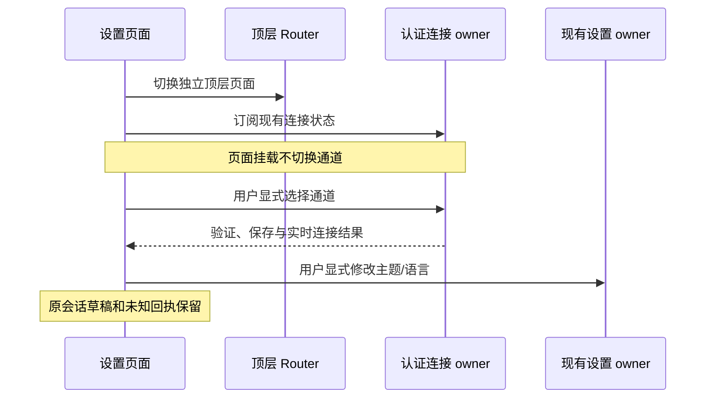

# CodeLight 手机顶层导航与全局设置

## 页面规则

- 手机顶层包含「会话」(`/`) 与「设置」(`/settings`) 两个独立页面；已配对的顶层页面显示统一底部导航。
- 顶层切换使用现有 Router 导航，返回会话页复用原页面，保留搜索、项目展开和列表位置。重复选择当前页不重载、不发起连接或原会话操作。
- 会话列表只承担项目/会话浏览、搜索与同步反馈。完整连接选择、语言和扫码配对位于全局设置；聊天页移除输入区附近的网络按钮，仅在 header 放一个当前连接图标，点击后复用同一切换表单。
- 设置按「连接」「显示」「关于」组织。连接包含当前通道选择与扫码配对；显示包含主题与语言；关于显示 CodeLight 版本。
- 连接选择仍由 `codeLightConnection` 唯一拥有；设置页订阅真实状态、复用现有选择表单，不另存连接或 peer 状态，也不在页面挂载时自动切换。
- 主题与语言复用现有设置所有者。主题实时应用到原生外观、键盘、页面与底色；语言继续走现有语言页及其保存/重启流程。
- 顶层导航和设置页面不向原 Codex 发出导航、输入或控制请求，不清除草稿、未确认操作或会话缓存。
- 会话列表离开前台时暂停其可见项目状态读取；设置页不为显示连接状态加载任何聊天历史。
- 进入会话后先排队新鲜读取并展示“正在同步”。缓存中的断连/不可用状态不构成本次失败；只有当前读取或当前选择确认失败后才显示错误和 Retry。重试立即回到同步状态，旧请求的结果不能覆盖新请求。
- 目录标题刷新不阻止浏览或点击已有会话。已配对手机启动时先恢复当前账户绑定的加密目录缓存，并立即开放列表；缓存不能确认原会话活跃状态。启动、前台重连与 Retry 在异步目录请求之前排队新的同步 generation，清除上次错误的显示资格。连接正在恢复或目录尚未新鲜确认时显示标题同步；只有当前连接上的当前目录读取失败才显示可重试错误。单个会话的最新读取独立于全目录标题同步。
- 保存地址在 Mac 暂停/启动后失效时，冷启动 `connect_error` 与断连都触发现有自动选路所有者；选路进行中不重复启动。Socket.IO 每次重试先进入 connecting，并生成新的单次设备证明，复用其现有重试/backoff，不新增 native mutation 重发。会话正文在连接恢复期间显示同步；连接恢复为 ready 之前，Sync 为可见会话与目录先排队新 generation，再启动新鲜读取，旧失败不能短暂回到错误界面。
- 正文加载条与 source banner 遵守相同连接恢复规则。桌面选择的 authority 在 peer 模式下绑定当前认证 Mac 身份，不能因同一 peer 更换地址误报失败；不同 peer 仍拒绝，legacy 连接保留原 endpoint 隔离。

## 布局与视觉

- 沿用现有主题：页面 `#F2F2F7`、卡片 `#FFFFFF`、正文 `#000000`、辅助文字 `#8E8E93`、强调色 `#2BACCC`、已确认状态 `#34C759`；暗色使用对应主题 token。
- 使用 IBM Plex Sans 的标题/正文、IBM Plex Mono 的版本信息；CodeLight 标识沿用现有品牌组件。页面保持单列分组，连接状态在一个完整设置行中呈现。
- 底部导航遵守安全区，点击区域至少 48pt；设置内容可滚动，支持长文案、字体放大与横屏，不叠加重复导航标题。

## 所有者与操作顺序

## 验收场景

1. 已配对会话页只显示浏览/搜索内容，底部有会话、设置入口；设置页为独立路由，返回保留列表状态。
2. 打开设置不触发通道切换或原会话 RPC；连接行显示实际当前选择，手动/自动切换沿用现有身份和错误保留。
3. 主题可实时切换，语言页可返回设置，扫码配对仍由用户显式启动。
4. 原生模拟器检查浅色、深色、安全区、导航返回、连接选择表单及长文案；真机安装后确认实际布局与原会话继续可用。
5. 聊天输入区没有网络选择按钮；header 的网络图标保留可访问名称、44pt 点击区域和当前连接状态，点击打开现有选择表单，不挤压标题或替换会话信息入口。
