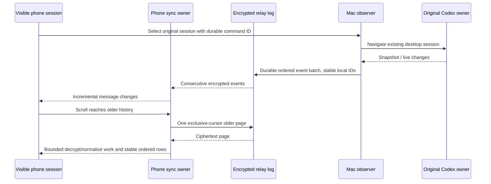

# Mobile performance and energy budget

The reported problem is entering a session and scrolling its history on iPhone. The phone displays the original Codex owner's events; it never starts a replacement runner.

## Owners and ordering

## Rules

- Open the latest 50 encrypted records first. CodeLight performs no speculative older-history loop; scrolling keeps the entire log accessible, one exclusive-cursor page at a time. Resume catches up forward without skipping records.
- A consecutive live event already admitted to the queue does not also cause an HTTP message refetch or unsupported Git RPC. Gaps still require forward reconciliation. Duplicate events do not replay commands.
- Native CodeLight navigation retains one session route. A session mount must not accumulate hidden chat renderers after many selections.
- Decryption/normalization is split into bounded chunks with event-loop yields between chunks; yields are scheduling only, never admission or ordering guards.
- Message changes merge into the existing sorted array. Lifecycle-only records preserve the array; unchanged sessions reuse a selector result across unrelated message-store writes.
- Once the phone pins its oldest rendered row, re-renders retain that exact boundary. The turn-boundary allowance applies only to the initial choice or a reader-triggered window growth, avoiding a second automatic expansion when cached long history mounts.
- Warm catalogs use the relay's existing changedSince filter with a one-millisecond overlap. The relay returns scanWatermark captured before querying the first page; use this conservative watermark rather than the newest row timestamp, which can skip a concurrent change to an earlier page. Older relays without this field retain the previous watermark. Merge by session ID, retain previous pages on failure, and advance the watermark only after a complete successful fetch. Account scope and fetch generation fence cache publication.
- Long Markdown initially lays out at most 8,000 characters. Load more reveals another chunk; copying still uses the complete original content. No source text is deleted.
- When backgrounded with no pending send, the phone closes its realtime socket. Resume reconnects and reconciles the visible session. Existing 15-minute registrations migrate to the 60-minute v2 task. Background refresh is limited to the most recently viewed session and one page; older history belongs to foreground scrolling.
- Mac observer transport publishes ordered batches of at most 50 records / 256 KiB. Ciphertext is durable before POST, acknowledgments are verified before marking events sent, and lost acknowledgments reuse the same ciphertext/local IDs. Single-record oversized payloads remain valid.

## Acceptance

### Bounded conversation observers

The conversation controller budget must allow repeated project selection beyond
sixteen distinct sessions. Reuse warm observers and retire the least recently
used eligible observer when at capacity. Retiring closes only CodeLight's follower
and socket; the original Codex runtime continues.

An observer currently viewed by a connected foreground phone, involved in source
navigation/start, or holding unsettled input/command work cannot be retired.
Admission and retirement need an atomic guard, not a check followed by an
unguarded close. Preserve binding keys, ciphertext, projection/receipt journals
and unknown outcomes; remove the retired actor from automatic restoration. A
single capacity reservation serializes competing preparations.

Retired conversation observers pause that conversation's detailed synchronization
and notification observation until reopened. The foreground project activity
service separately keeps small summaries within its own bounded interest lease.

Measure request counts and CPU work against the previous implementation using fixed, synthetic long histories and real current encrypted payload sizes without retaining private content. Cover cursor continuity, stale fetches, duplicate/lost ACKs, sorted order including pending messages, native route reuse, bounded Markdown and foreground/background transitions. Record device/simulator results separately. Avoid promising a cold phone: actual energy and thermal behavior must be measured on a connected iPhone; host benchmarks establish relative work reduction only.
