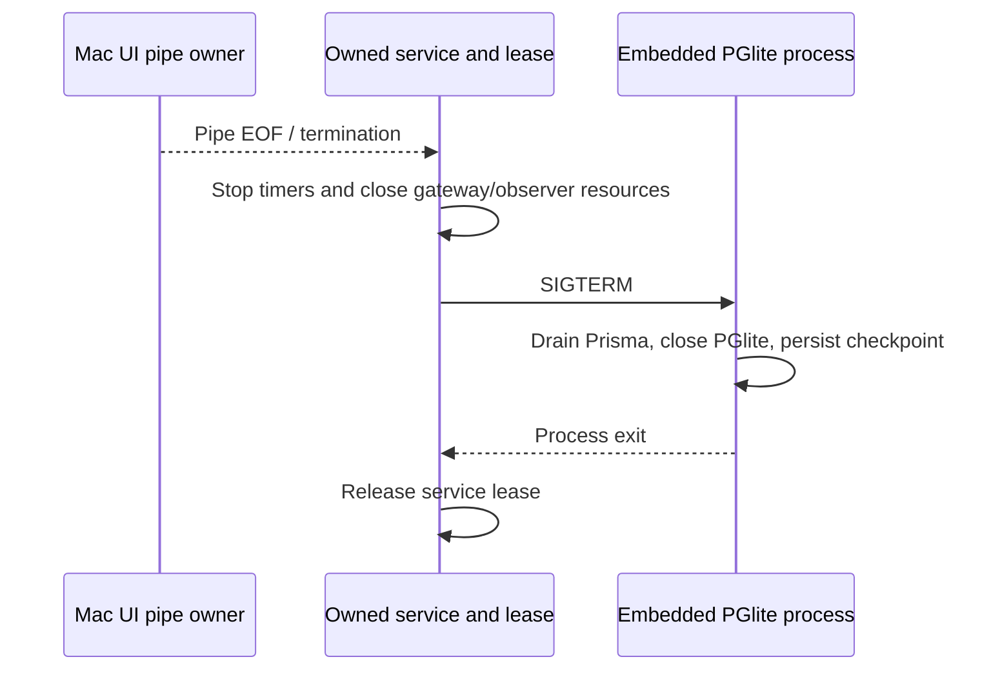
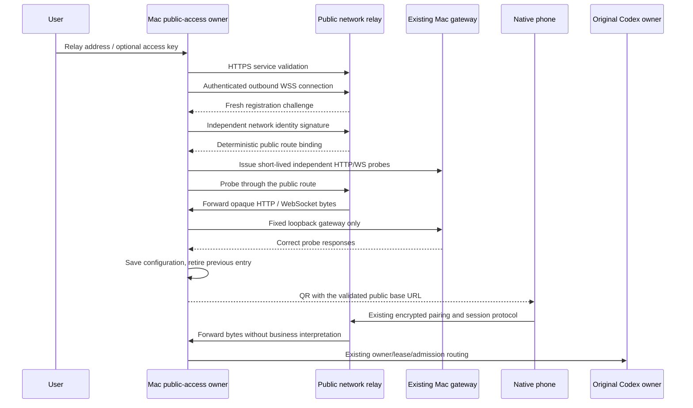

# Local and public connection channels

## Saved-peer cold startup

Peer authentication owns nonce generation and uses the native system
cryptographic random source before pairing UI providers mount. Saved v2
credentials must cold-start/reconnect without UI-installed global PRNG state.
No weak randomness or key deletion is a recovery path. Acceptance covers QR
exchange/reload, stored v2 cold launch, and a distinct nonce on reconnect.

## Same-peer channel transitions

Channel probes use the native AbortController instance API; DOM-only static
AbortSignal.any/timeout methods are not assumed. A verified same-peer transition
updates both the persisted and active runtime endpoint, while changing account
or peer retains the existing reload boundary. A failed switch restores the old
endpoint and credentials. Old peer read requests are cancelled on channel change
and cannot publish into the new route. Catalog/recent reads have explicit network
budgets and publish a visible retry state on failure.
The sealed WebSocket proof signs the exact Engine.IO path, including its trailing
slash. A strict receiver is not relaxed to accept a differently signed path.

## Embedded mirror shutdown and recovery

The embedded PGlite process owns its database. Shutdown drains the Prisma client
and then closes PGlite explicitly so its checkpoint reaches disk. A Prisma
disconnect alone cannot stand in for database close. The Mac pipe's EOF and a
broken output pipe stop the owned service; cleanup errors cannot skip terminating
its owned children. The service lease is released after child termination.
Recovery preserves the original directory, account keys, command IDs and receipt
journals. Rebuilding encrypted mirror rows from acknowledged projection journals
must retain their original IDs, sequences and timestamps; it never replays native
commands. Recovery coverage and any unconfirmed tail are recorded separately.



## Accepted multi-channel iteration (2026-11-01)

Mac owns one account, encrypted backend, source registry and operation receipt
store. Its local LAN, Cloudflare and configured Relay entries may run at the
same time. First configuration/migration defaults to all available checkboxes;
later explicit checkbox changes persist. Relay's checkbox is absent until a
server is configured. A failed or disabled entry affects only that entry.
Local entries advertise actual private LAN addresses, not loopback or public
interfaces. Settings, startup generation and route retirement have one owner.

A v2 QR conveys the pinned Mac key, expiring invitation and bounded channel
list. Pairing authenticates one peer and returns the same account/session
identity plus an authenticated endpoint manifest. The phone automatically
chooses a proven available route and exposes manual switching in its connection
sheet. It does not ask for server/account setup for each route. Endpoint updates
are accepted only from the paired Mac, never from an untrusted URL list.

The phone connection control subscribes to the single connection owner. A compact
button opens the existing native picker sheet with Automatic and the paired
local/Cloudflare/Relay routes, showing only a local IP or hostname, current
state, and measured latency when known. It does not accept addresses or keys.
Selection calls the owner's `selectConnection`; pending selection disables
repeat taps, and failure keeps the existing route with visible retry feedback.
An old peer's completion cannot change the new peer's sheet state. Closing the
sheet does not disconnect the current route or submit a session operation.
The control is inline in the directory action area and the chat input dock above
the question banner. It remains reachable while reading older history, with no
floating global overlay over the header or pending question. Its independent
subscription does not invalidate the message list or regroup the directory.
All Sync account/machine/settings/profile HTTP requests use the peer-aware
transport on v2 connections; ordinary LAN requests must not bypass its sealed
authorization by sending a raw reusable bearer token.

Local HTTP must retain encrypted content and must not send reusable bearer
tokens in cleartext. V2 phones retain their device box key in native secure
storage and use key-bound, short-lived sealed authorization for local requests.
The Mac validates nonce/time/request scope and approved-device identity, then
supplies its backend token only on the owned loopback link. Public channels keep
HTTPS/WSS certificate validation. Device revocation applies across all entries.

Phone account/cache/operation identity is the authenticated peer and entity,
not the selected URL. Switching channels keeps session/message state and
original command IDs. Uncertain operations recover by receipt-only queries on
a proven channel of the same peer; channel changes never automatically replay
mutations. Legacy records without enough peer proof stay isolated and preserved.
Request encryption and socket callbacks are fenced against connection or peer
changes. Automatic route changes happen on initial connection, foreground
recovery or failure; there is no continuous all-route polling loop.

### Mac connection owner and native controls

`ConnectionChannelsManager` is the sole writer of private
`connection-channels.json` version 2. It reuses `network-identity.json` and reads
the old single-entry `network-access.json` only on first migration. The v2 file
contains enabled channel kinds and the configured Relay address/key; emitted
configuration exposes only `enabledChannels`, `relayConfigured`, `serverUrl`
and `hasToken`. First migration enables local LAN and Cloudflare plus Relay if
configured. Configuring Relay for the first time enables its newly available
checkbox; replacing an existing disabled Relay preserves that explicit choice.

Configuration writes serialize, while channel startup and probes run separately.
`load` and checkbox changes do not wait for every network channel. The owner
keeps per-channel generation/cancellation fences and closes late startup results
after a disable or shutdown. Failed Relay replacements retain the prior saved
configuration and entry. Keys may be reused only for the same canonical server.
Local entries advertise at most six distinct actual private LAN URLs; loopback
and public host addresses are rejected. The two public entries complete the
bounded eight-channel QR contract.

Channel snapshots expose `starting`, `ready`, `unverified`, `reconnecting` or
`unavailable` states with known URLs. A Cloudflare process URL is advertised as
unverified until the Mac's read-only HTTP/WebSocket probes or an authenticated
paired-device confirmation prove it. A local DNS/probe failure does not close
that candidate or block LAN/Relay. Relay startup and replacement require service
identity plus both owned gateway probes. An authenticated confirmation can mark
only an existing enabled kind/URL ready; it cannot inject a new endpoint.

The native Mac connection section shows independent checkboxes for Local
network and Cloudflare, and a Relay checkbox only after successful configuration.
Relay address/key settings remain available under a separate disclosure, with
explicit validation feedback. It sends `set-enabled-channels` and
`configure-relay` requests carrying request IDs and consumes sanitized
`access-configuration`, `access-channels` and `access-result` events. Statistics,
manual Statistics/Pairing selection and hidden QR image caching retain their
owners. The pairing hint explains that address changes may require a new scan;
it does not describe every connection as temporary.
Native service output is accepted only from the current Process instance.
Service restart/failure clears connection observations and pending UI request
flags; old process callbacks cannot restore a stale ready state or pairing QR.

The Mac service composes these entries through one connection service. Cloudflare
and Relay each receive a separate loopback gateway. Enabled LAN binds use at
most three unique actual private IPv4 interface addresses; no wildcard, public
or loopback listener is advertised as LAN. All gateways share one invitation
issuer, approved-device registry, nonce verifier, traffic metrics, account and
Codex daemon. LAN requires sealed device proof; public HTTPS retains the legacy
approved-device compatibility path. Every proof is bound to that gateway's
advertised origin, and disabled/unknown origins cannot confirm readiness.

Authenticated `/api/peer/channels` returns the current enabled candidate list.
`/api/peer/catalog` reads the index without starting history observers. Selected
`/api/peer/sessions/:id/recent` and explicit-cursor `/history` use the existing
daemon source owner and retain its source-use pin through preparation, startup
and the full native read. They never navigate the desktop or create a model
runner. Replies remain sealed to the approved phone and bound to the stable
Mac/account peer identity. Repeated channel confirmations do not rotate the QR;
only changed route sets/primary origin, explicit refresh or scheduled expiry
renewal create another invitation.

```mermaid
sequenceDiagram
    participant Mac as Mac connection owner
    participant LAN as Private LAN entry
    participant CF as Cloudflare entry
    participant Relay as Configured Relay entry
    participant Phone as Phone peer/transport owner
    participant Runtime as Original Codex owner
    par Enabled startup
        Mac->>LAN: Start owned private entry
    and
        Mac->>CF: Start outbound tunnel
    and
        Mac->>Relay: Start authenticated outbound tunnel
    end
    Mac-->>Phone: QR + pinned key + enabled channel list
    Phone->>Mac: Key-bound pairing on available candidates
    Mac-->>Phone: Authenticated peer/account/channel manifest
    Phone->>Phone: Prefer available route; retain manual choice
    Phone->>Mac: Original operation ID through selected entry
    Mac->>Runtime: Existing owner/lease/admission
    Note over Phone,Mac: Same peer/session across routes; lost replies query original receipts
```

## Existing single-entry protocol baseline

## Product rule and owners

Mac offers Cloudflare or Relay public access. In Relay mode the user supplies a
compatible HTTPS relay server address and, when required, an access key. Validate
service identity, authenticated outbound tunnel registration and actual HTTP plus
WebSocket reachability before saving or replacing the current public entry.
Failure preserves the previous working entry. Phone users still scan the same
CodeLight QR and use the native app; they do not select or configure a provider.

The public relay is a network service. It owns authenticated connection bindings,
ephemeral stream buffers, heartbeat and forwarding only. It must not hold agent
runtimes, session catalogs, snapshots, question queues, commands or account keys.
Mac continues to own its encrypted local relay/gateway and original Codex routing.
This public-access mode is separate from the required gateway connection mode of
desktop Codex itself.



## Routing and phone transparency

One TLS hostname can serve multiple Macs through `/r/<network-public-id>` base
paths. Network identity is independent from the account encryption key; its public
route is derived from an authenticated signing key and stays stable across
reconnections. Another authorized client cannot claim that route without its key.
Use one server replica until distributed connection routing is explicitly built.

QR version and encrypted key exchange remain the same. Its `origin` field is the
canonical server base URL and may contain the validated relay prefix. Phone REST,
Socket.IO, background refresh and local-file URL rewriting must retain that prefix.
Socket.IO uses the URL's origin plus a prefix-aware updates path, never a pathname
mistaken for its namespace. Authorization headers must not attach to a different
Mac's prefix on the same hostname. The phone UI does not gain relay settings.

## Security and resource bounds

- HTTPS/WSS certificate validation remains enabled. Permit plain HTTP only for
  loopback tests; reject credentials, query and fragments in a server address.
- Production registration requires a high-entropy access token, sent only to the
  selected server. Reuse a saved key only for the same canonical server address.
  Never put it in the phone QR, logs, bundle, source or public website.
- Fresh challenge signing binds the independent Mac network identity. Handover
  and old-connection cleanup must be generation-fenced.
- Public requests route only to an existing authenticated binding. The Mac client
  forwards only to its owned loopback gateway, with no caller-controlled target
  URL, arbitrary destination dial, CONNECT or open forward-proxy behavior.
- Stream opaque bodies in bounded binary chunks. Per-stream credit and channel
  backpressure bound buffering; cap peers, active streams, headers, frame sizes,
  body bytes and handshake/request time. Do not buffer whole message histories.
- Network reconnect re-establishes the route only. It never replays requests or
  commands. Lost HTTP/WS connections fail visibly; original command receipts and
  unknown outcomes remain authoritative on Mac.
- A trusted public relay sees transit headers, ciphertext, routing and timing;
  it does not receive account encryption keys. No payload/header persistence or
  ordinary logs. Current owned-gateway metrics keep the same byte definition.

## Acceptance

Cover wrong address/version/key, redirect/TLS refusal, challenge replay, foreign
route claims, old-close races, unknown bindings, malformed envelopes and bounds.
Verify streamed HTTP content and headers, upgrade traffic, flow-control credit,
connection cleanup and stable reconnect without replay. Validate failure preserving
an existing entry and saving only a fully proven entry. Check native Mac selection,
address/key entry, validation feedback and QR; verify prefixed phone REST/WS,
pairing, file authorization scope and root Cloudflare compatibility. Update public
docs/website, re-build the final Mac and obtain fresh accepted notarization before
publishing this version.
