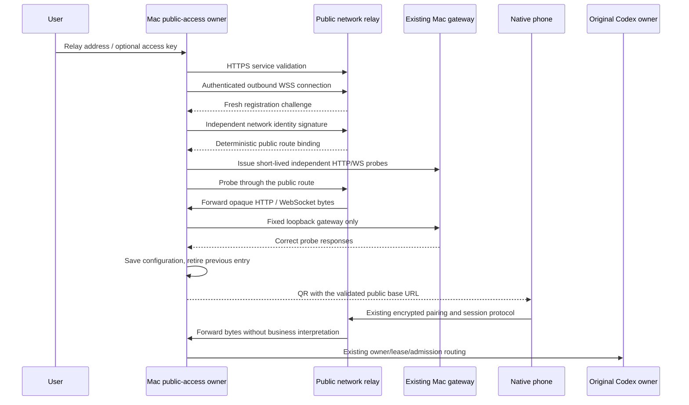

# Optional public network relay

## Product rule and owners

Mac offers Cloudflare or Relay public access. In Relay mode the user supplies a
compatible HTTPS relay server address and, when required, an access key. Validate
service identity, authenticated outbound tunnel registration and actual HTTP plus
WebSocket reachability before saving or replacing the current public entry.
Failure preserves the previous working entry. Phone users still scan the same
CodeLight QR and use the native app; they do not select or configure a provider.

The public relay is a network service. It owns authenticated connection bindings,
ephemeral stream buffers, heartbeat and forwarding only. It must not hold agent
runtimes, session catalogs, snapshots, question queues, commands or account keys.
Mac continues to own its encrypted local relay/gateway and original Codex routing.
This public-access mode is separate from the required gateway connection mode of
desktop Codex itself.

## Routing and phone transparency

One TLS hostname can serve multiple Macs through `/r/<network-public-id>` base
paths. Network identity is independent from the account encryption key; its public
route is derived from an authenticated signing key and stays stable across
reconnections. Another authorized client cannot claim that route without its key.
Use one server replica until distributed connection routing is explicitly built.

QR version and encrypted key exchange remain the same. Its `origin` field is the
canonical server base URL and may contain the validated relay prefix. Phone REST,
Socket.IO, background refresh and local-file URL rewriting must retain that prefix.
Socket.IO uses the URL's origin plus a prefix-aware updates path, never a pathname
mistaken for its namespace. Authorization headers must not attach to a different
Mac's prefix on the same hostname. The phone UI does not gain relay settings.

## Security and resource bounds

- HTTPS/WSS certificate validation remains enabled. Permit plain HTTP only for
  loopback tests; reject credentials, query and fragments in a server address.
- Production registration requires a high-entropy access token, sent only to the
  selected server. Reuse a saved key only for the same canonical server address.
  Never put it in the phone QR, logs, bundle, source or public website.
- Fresh challenge signing binds the independent Mac network identity. Handover
  and old-connection cleanup must be generation-fenced.
- Public requests route only to an existing authenticated binding. The Mac client
  forwards only to its owned loopback gateway, with no caller-controlled target
  URL, arbitrary destination dial, CONNECT or open forward-proxy behavior.
- Stream opaque bodies in bounded binary chunks. Per-stream credit and channel
  backpressure bound buffering; cap peers, active streams, headers, frame sizes,
  body bytes and handshake/request time. Do not buffer whole message histories.
- Network reconnect re-establishes the route only. It never replays requests or
  commands. Lost HTTP/WS connections fail visibly; original command receipts and
  unknown outcomes remain authoritative on Mac.
- A trusted public relay sees transit headers, ciphertext, routing and timing;
  it does not receive account encryption keys. No payload/header persistence or
  ordinary logs. Current owned-gateway metrics keep the same byte definition.

## Acceptance

Cover wrong address/version/key, redirect/TLS refusal, challenge replay, foreign
route claims, old-close races, unknown bindings, malformed envelopes and bounds.
Verify streamed HTTP content and headers, upgrade traffic, flow-control credit,
connection cleanup and stable reconnect without replay. Validate failure preserving
an existing entry and saving only a fully proven entry. Check native Mac selection,
address/key entry, validation feedback and QR; verify prefixed phone REST/WS,
pairing, file authorization scope and root Cloudflare compatibility. Update public
docs/website, re-build the final Mac and obtain fresh accepted notarization before
publishing this version.
