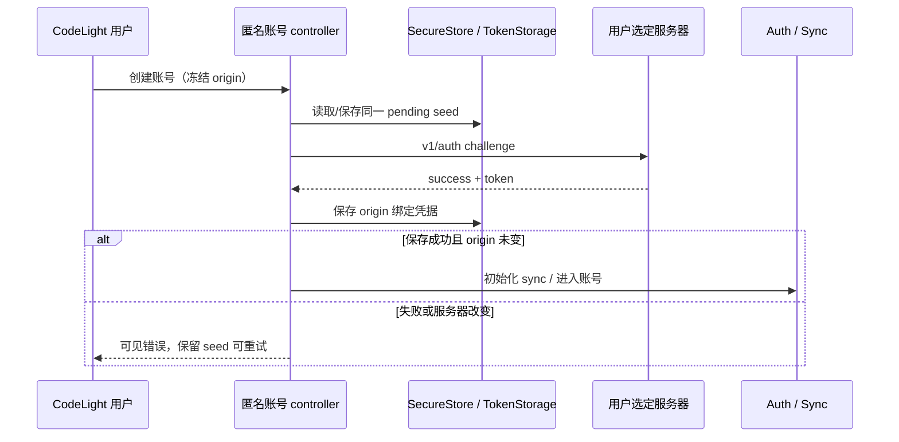

# CodeLight 首次使用与恢复

> **历史手动配对流程（2026-10-31）**：本文件记录此前的服务器选择与匿名账号创建路线。当前 Codex-only 发行使用 Mac App 一次扫码配对，正常手机界面不要求注册、账号创建、服务器选择或 VPN，详见 [一次扫码合同](codelight-one-scan.md) 与 [当前产品合同](codelight-product.md)。高级自建服务诊断不改变正常首次使用流程。

2026-10-29。原生正常 Release 不要求 Harness token，也不访问 Happy 公共默认服务。用户先选择与 Mac `start-codelight.sh --server` 相同的自建服务，再创建或恢复匿名账号，扫描/粘贴 Mac 的 CodeLight 配对链接。

## 状态与写入所有者

- 当前服务器由现有 serverConfig 持久存储拥有；只接受明确 HTTP(S) origin，拒绝 userinfo、路径、query、fragment，存储标准化 origin。服务切换必须令原账号连接退出/清理，不能让新地址继续使用旧 token。
- CodeLight 运行时固定当前服务器直到自己的 JS runtime 重载；选择新地址后重载自身 App，避免旧异步网络任务跨到新地址。使用 Expo 已提供的 reloadAppAsync，不依赖被关闭的 OTA 更新服务。服务器输入键盘打开时 Save 第一次点击就应执行，不被 ScrollView 当作仅收键盘事件。
- 账号凭据由 TokenStorage/SecureStore 拥有，并绑定选定 server origin；安全存储失败不得启动 sync 或显示登录成功。
- 创建账号意图由单一匿名账号 controller 拥有：先将随机 seed 按 server origin 保存至 SecureStore，再发已有 `/v1/auth` challenge。并发点击合并为同一个 flight；网络/回执/凭据写入失败后重试仍用同一 seed，不生成第二个匿名身份。
- 正常账号创建、手动恢复和设备恢复均冻结此次目的服务器；服务器在 await 期间改变时拒绝登录到另一服务器，保留原创建意图供恢复。
- `auth/request/status=not_found` 是链接不存在/过期或服务器不匹配，不是配对成功。authorized 可幂等完成；当前账号不存在、安全存储/加密初始化不可用或链接 key 无效时明确提示。
- Native 首次界面必须给出可见错误和重试，保持服务器选择可达；不只 console.log。Mac 指令显示 `start-codelight.sh` 与当前服务器，不指向 Happy 官网或全局 Happy CLI。MIT 归属保留。

## 验收

1. 正常无 Harness 启动可选择自己的服务器、创建匿名账号、配对 Mac，不启动模型 runner。
2. 重复点击只一次 authenticate；ACK 丢失、SafeStore 写入失败及重启重试复用原 seed。
3. token 缺失、请求错误、安全存储错误及服务器改变均无假登录、无 sync。
4. codelight 与既有 happy 配对/恢复前缀兼容，但 CodeLight UI 只生成 CodeLight 链接；无效、过期、不匹配链接提示可见。
5. 真实服务 fresh test identity 的相同 seed 返回同一账号；该验证只创建测试账号，无真实模型/GUI调用。
