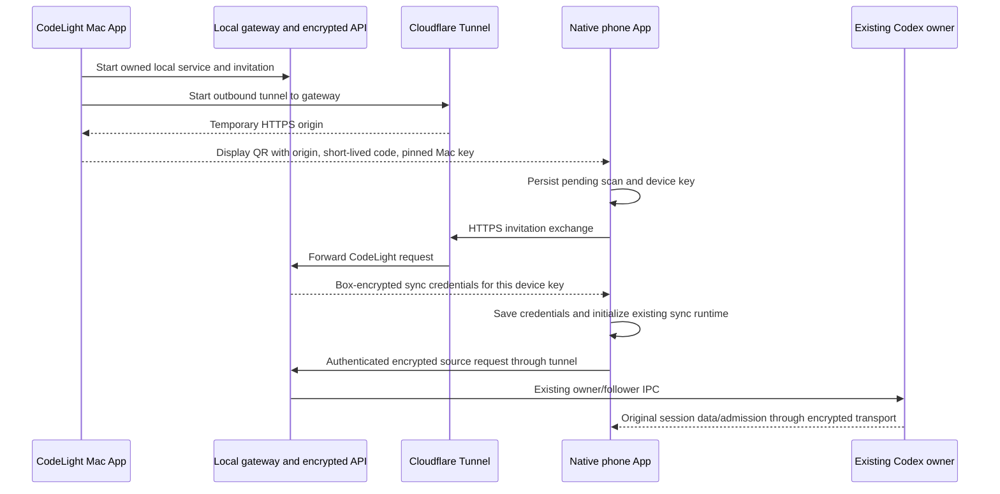

# CodeLight one-scan connection — 2026-10-31

> This document preserves the v1 one-scan baseline. The accepted 0.5 multi-channel
> rules in [the connection contract](codelight-network-relay.md) supersede its
> earlier single-tunnel/reconnection deferral. A new phone receives one pinned-key
> QR for all enabled channels, chooses an available verified route automatically
> and retains a manual Connection sheet. Legacy public v1 compatibility remains
> separate; it does not permit plain bearer authorization on LAN.

## Product rules

The user wants to open a local CodeLight Mac App and scan its QR code from the native phone app. The phone must not ask for registration, account creation, server selection, setup checkboxes, VPN installation, or VPN permissions. Camera permission is the operating system's normal first-use permission.

The Mac App contains the local encrypted sync API, CodeLight Connector, and Cloudflare Tunnel client. Only CodeLight HTTP/WebSocket traffic reaches that tunnel. The original Codex desktop continues to own its sessions and turns. The current distribution is Codex-only; other harnesses and window control are deferred, as defined in the [product contract](codelight-product.md).

The user explicitly deferred automatic reconnection. This iteration may use an anonymous Cloudflare Quick Tunnel. Its address can change after a Mac App restart; the phone then scans again. A fixed domain/named tunnel is a later option. Connectivity requires an online Mac and a network that can reach the tunnel service.

## State owners and interfaces

- Mac service supervisor owns only its embedded API and tunnel processes, pairing invitations, and the CodeLight daemon. The SwiftUI Mac App owns that supervisor process and displays its bounded status/QR events.
- An independent application-support directory owns the local database, relay master key, Mac box key, internal owner identity, native projection journals, and receipts. A file lease permits only one supervisor for that directory.
- The API and Mac Connector use one fixed loopback origin internally. The temporary public tunnel address is a phone transport endpoint, not a replacement for the Mac's durable native identity or receipts.
- The pairing gateway owns short-lived invitations and forwards the authenticated sync API and WebSocket upgrade to the embedded loopback API. It exposes no unauthenticated source control, arbitrary proxy target, filesystem API, or public endpoint to obtain new invitation codes.
- The existing realtime transport uses the Socket.IO path `/v1/updates`, including its optional trailing slash and query string. That exact path is forwarded; unrelated upgrade paths are rejected.
- The phone pairing controller owns one in-flight scan. SecureStore owns its pending scan/ephemeral key and saved credentials. AuthProvider and the existing sync runtime continue to own the active authenticated session.

## QR and invitation exchange

`codelight://pair?v=1&origin=<HTTP(S)-origin>&invite=<base64url-32-byte-code>&key=<Mac-box-public-key>&expires=<epoch-ms>`

The parser rejects unknown/duplicate fields, credentials, fragments, non-origin URLs, invalid keys/codes, expired invitations, and oversized payloads. Public endpoints require HTTPS; local-network development endpoints may use HTTP.

Before network activity the phone stores an ephemeral box key and the original scan. It encrypts `{version:1,invite,origin}` to the QR-pinned Mac key and POSTs `{publicKey,nonce,ciphertext}` to `/codelight/pairing/exchange`. The public tunnel never receives a plaintext invitation. The invitation is one use: the same device key can obtain the exact cached encrypted response after a lost ACK; another key is rejected. The invitation grants only the current Mac's internal sync identity. No user profile or signup form is created by the phone flow.

The response is encrypted with the QR-pinned Mac key and the phone's ephemeral public key. Its decrypted origin must exactly match the scan. It carries only the local sync credential and encryption key needed by the existing transport, never Codex/provider credentials.

The Mac can renew a displayed QR while retaining still-valid previous invitations. Expired grants are bounded and removed. Codes/private keys/tokens are excluded from logs, source archives, and distribution bundles; the QR is displayed only in the local Mac UI.

## Phone event order

1. Scan and validate the complete QR.
2. Persist the pending scan and device key before any network request.
3. If its origin differs, persist the selected origin and reload the phone's own JS runtime; the pending scan resumes automatically. Old authenticated work never sends old tokens to a new origin.
4. Exchange the invitation and authenticate/decrypt against the pinned Mac key.
5. Persist credentials before completing login. If an existing initialized runtime would change identity, reload using the saved credentials instead of initializing a second owner.
6. Clear the pending pairing only after credentials/login succeeds; show the existing session list. Repeated scans/recovery reuse the same pending device key and cached grant.



## Lifecycle and verification

- Quit/restart stops only owned service/tunnel/observer processes, preserves state, and never stops/restarts the original Codex desktop or replays unknown commands.
- Offline status is explicit. A disconnected tunnel is not reported as ready; the QR is offered only after the gateway is reachable at its advertised origin.
- Bundled runtime/dependencies work without a terminal, package manager, Metro, or externally installed cloudflared. Signing applies only to the new CodeLight distribution.
- The Mac package reads the existing Codex index through its bundled Node SQLite worker in read-only mode. It does not depend on Python or Xcode Command Line Tools on the target Mac.
- Tests cover invitation expiry, pinned key/origin validation, same-device retry and foreign-device replay, secure-storage failure, concurrent scans, runtime reload/resume, owner/receipt preservation, HTTP/WebSocket proxying, and process teardown.
- Native first-use verification uses a clean simulator or phone flow with no preseeded credentials and sends no model test prompts.

## Device management and session navigation

The Mac manages paired devices by a persistent phone box public key. Each device receives its own scoped sync token; its token hash, name, created/last-seen times and revoked state are owned by a private Mac device registry. The phone saves its device key before scanning/network IO and reuses it on subsequent scans.

The public gateway admits only active registered device tokens. Its HTTP and realtime-upgrade admission use Authorization headers; an admitted WebSocket is associated with its device. Revocation is persisted before sockets close, rejects future requests, and does not affect other devices or the original Codex owner. Public account-authentication routes are unavailable, so possessing an old content key cannot mint a new permitted gateway token. Internal Mac API calls continue to use the loopback owner credential.

The local Mac UI lists devices, shows connection/last-seen state, and offers rename and revoke actions through the supervisor's local UI pipe. No device list or administration method is exposed through the public tunnel.

Phone CodeLight navigation exposes scan/connection, session discovery and original session control. General upstream settings are not shown. Session discovery reads every active index record in bounded batches; metadata retains original recency, parent/agent identity, project path, pinned state and a bounded preview. Titles use the current name/title, then agent identity or first-user preview, then a stable short ID. A virtual native list supports project grouping and search across all records, while child-agent sessions remain identifiable and expandable.

### Project grouping and immediate selection correction

- A project's folding identity is distinct from a session's working directory. The readonly Mac discovery resolves the desktop's explicit project assignment first, then parent assignment, Git common directory, known project-root ancestry and unambiguous managed-worktree aliases. Main checkout, worktrees and subdirectories of the same project share one encrypted project descriptor. Same-name independent projects stay separate. `metadata.path` remains the original workspace path for native control and display.
- Phone fold state keys on the project descriptor and Mac/source scope. Each group is emitted once, and native parent links can cross a worktree within that group. No project rename or filesystem mutation occurs.
- Every explicit session tap requests desktop navigation immediately, even if that source is already connected or was visited before. The phone starts that request at tap time and opens its own session screen without waiting for history or the native owner's initial snapshot. Preloading, background refresh and foreground reconciliation do not cause another desktop navigation.
- The Mac holds its source lease before navigation, confirms only that the original App accepted the navigation request, and starts/continues the observer asynchronously. A slow initial snapshot cannot block subsequent session selections. Current owner readiness and messages remain confirmed by the existing metadata/stream.
- Selection requests have stable command IDs and a per-phone monotonic selection order. The newest explicit choice wins when requests arrive out of order. Unknown receipts are retained and never replayed automatically; a new user tap is a separate authorized navigation action.
- The normal session screen shows automatic connection progress and contains no Open Desktop button. A failed connection can expose Retry, using a new explicit user action.

### Progressive loading and session controls

- Discovery decrypts and publishes each metadata page before waiting for the remaining pages. The first usable rows are shown immediately, with a spinner and discovered-session count while the remainder loads. The first empty loading frame must not present `Sessions 0` as a completed result. Fold state and search remain usable as more rows arrive.
- Cached descriptors hydrate in bounded batches too. The cache stores only a complete successful network snapshot; a failed later page retains visible rows and reports retryable loading failure without replacing the complete cache with a partial list.
- The sync runtime owns discovery progress and selected-session message progress. A newer discovery generation supersedes an older one; it cannot show an obsolete completion/error over a current load. Metadata and message loading are separate: entering an already connected source still shows message/history loading until its initial page is applied. Loaded content stays visible during reconnect or older-history backfill.
- Session controls expose the original session's model and supported reasoning efforts. Model catalogs come from the original host's available models. Native operations require a verified original-owner contract and receipt; phone-local picker state alone is never reported as a changed desktop setting. The user explicitly deferred worktree controls and uses text instructions for those operations.
- Native project conversations use a single session select box, preserving the existing selected identity and route. The phone foreground project view receives lightweight active/waiting status separately from selected-session message history. Stale, unknown and disconnected observations stay explicit; see [the project activity contract](codelight-project-activity.md).

## Eager titles, selected-session sync and background notifications

Opening the Mac App starts the complete metadata index scan, continuing periodically while its service runs. Cold phone discovery reads metadata across bounded pages; a warm catalog uses the changed-since delta path at startup, on foreground return and on realtime reconnect. The catalog watermark commits only after a complete successful scan. Discovery does not load every session's message history. Entering a Codex session is explicit authorization to activate that selected source through the original owner and begin message synchronization, without a second Open button.

Previously activated sources continue to be observed by the Mac when the phone leaves the foreground. iOS can suspend ordinary apps and their data socket; background refresh is scheduled opportunistically and foreground return reconciles missing increments. No silent audio or mobile VPN is used to evade suspension.

Remote notifications use APNs after the distribution has a valid push entitlement/profile and publisher key. Device tokens are bound to the device registry, and revoked devices receive no notifications. Only actionable new transitions are notified: completion, failure, and newly required user input/approval. Bootstrap history and unchanged state are quiet. A generic alert plus the session identity avoids sending private conversation text to APNs; tapping restores that session and reconciles its log. Push activation is reported as unavailable until actual signing/token/provider verification succeeds.

### Background cache and admission boundaries

- One Expo BackgroundTask worker is defined before Router loads. It reads bounded encrypted metadata and at most one recent visited session/message page, with an abort deadline. It performs only authenticated reads and never initializes a second sync owner, dispatches native commands, or drains a phone outbox. Foreground project status has its separate lightweight budget.
- A dedicated ciphertext cache is fenced by a digest of origin and credentials. Selected sessions and message cursors share that fence. Foreground startup can decrypt the last complete metadata cache immediately, then replace it with fresh pages. Cached selected messages can render while the canonical message fetch reconciles. An identity change during a task discards its result.
- CodeLight credentials use device-only Keychain access after the first unlock, so a system-scheduled refresh can authenticate while the phone is locked. Existing credentials migrate on their next foreground read; no authentication secret is copied into the ciphertext cache.
- Passive source observation is single-flight by origin, account, machine, source and owner generation. A successful observation request is remembered within that phone runtime. Explicit user selection always navigates; background/foreground reconciliation never navigates. Failed selection exposes connection Retry instead of Open Desktop.
- The v2 background task requests a 60-minute minimum interval and migrates an installed v1 task that requested 15 minutes; iOS chooses actual runs. Force-quitting, disabled background refresh, battery policy and network availability can prevent a run. The CodeLight native configuration uses `processing`, without an audio keepalive.
- Native APNs registration and short-lived viewing presence are authenticated against the same device token as the gateway. Push state stays in the private device registry. A Mac-only APNs configuration file contains publisher key path, key ID, team ID, bundle topic and environment; no upstream Expo/EAS publishing identity is used.
- The notification observer establishes a quiet baseline on every attachment/restart. Durable per-device delivery IDs prevent duplicate alerts. Transient provider failures retry boundedly; invalid device tokens are disabled. A recent foreground presence suppresses alerts only for the currently viewed session. Revocation is checked again immediately before each dispatch.

```mermaid
sequenceDiagram
 participant O as Original Codex owner
 participant M as Mac observer and private notification journal
 participant A as Apple APNs
 participant B as iOS background worker
 participant P as Phone foreground sync
 O-->>M: Original session transition
 M->>M: Commit encrypted projection and deduplicate new actionable event
 M->>A: Generic alert and session ID, for active registered devices
 A-->>P: System notification; tap opens existing session
 B->>M: Bounded authenticated metadata and selected-message reads
 B->>B: Commit ciphertext cache only if origin/account still match
 P->>P: Hydrate fenced cache
 P->>M: Reconcile metadata delta and selected session
```

## Native model and reasoning controls — verified 2026-10-31

The original installed App's `.vite/build/src-tOjGKoT3.js` version table declares `thread-follower-read-model-settings` version 1 and `thread-follower-update-thread-settings` version 2. Remote-host requests add one to the follower version, preserving the existing owner/host routing. The saved admission-analysis main/renderer modules were SHA-256 matched to their current `app.asar` members before using their handler contracts.

- Read: `{conversationId}` returns original `settings` with `model`, `reasoningEffort`, `modelProvider` (and other native fields that CodeLight omits). The owner waits for pending thread-setting updates before replying.
- Update: `{conversationId,threadSettings:{model,effort},activeTurnId:null,condition:{ifModelEquals,ifEffortEquals}}`. This calls the original owner's `updateThreadSettingsForNextTurn`, including its `thread/settings/update` path and old-server renderer compatibility behavior. The settings belong to the existing original thread; they are not a one-message context override. The active turn is neither interrupted nor rewritten.
- Phone `codex-controls-update` accepts only `{commandId,model,reasoningEffort,expectedModel,expectedReasoningEffort}`. Both expected fields come from the phone's last read. A mismatching fresh read or native `applied:false` is `settings-conflict`; it is not success.
- After `applied:true`, original-owner readback must match model and effort before ordinary success. A lost/mismatching readback retains the original command ID as unknown and durably saves the exact applied acknowledgment, target model/effort and owner epoch. Later receipt queries or control reads may confirm that same ID by matching settings under the same owner and lease. They never issue another settings update. Unknown operations lacking applied evidence cannot be confirmed merely because the current values happen to match. The underlying original unknown receipt is preserved even when a same-owner observation confirms the public result.
- `codex-controls-read` has a stable readonly receipt and publishes `metadata.nativeControls` so the existing phone model/effort menus can update directly. Transcript projection is not blocked by model-catalog reads. A setting write fences older in-flight readonly results from overwriting its confirmed metadata.
- Wire shape: `nativeControls.model={available,current:{model,reasoningEffort,modelProvider},models:[{id,label,reasoningEfforts,defaultReasoningEffort}],catalogSource,reason?}`. Model and effort picks are admitted only when an original adapter explicitly advertises `supportsNativeModelSettings` and the source owner is available.
- The catalogue is loaded from the original selected provider's scalar configuration/catalogue. For a provider's bare ID response, those live provider IDs gate the desktop's existing native capability descriptions. A cache candidate absent from the provider response cannot become selectable. No provider key, account token, endpoint or raw configuration reaches phone metadata. An unavailable/unsupported provider catalogue leaves controls unavailable and reports the current original settings; it does not substitute a different account's default models.
- Actual readonly verification for the current `learnings` owner returned `gpt-6.1-sol`, null reasoning effort, and exactly three native picker entries after filtering: `gpt-6.1-sol`, `gpt-6.1-terra`, `gpt-6-luna`. Verification sent no inference prompt and started no model runner. Source: `evidence/private/codelight-native-controls-read-proof.json`.
- Worktree controls are omitted because the user explicitly cancelled them for this iteration.
