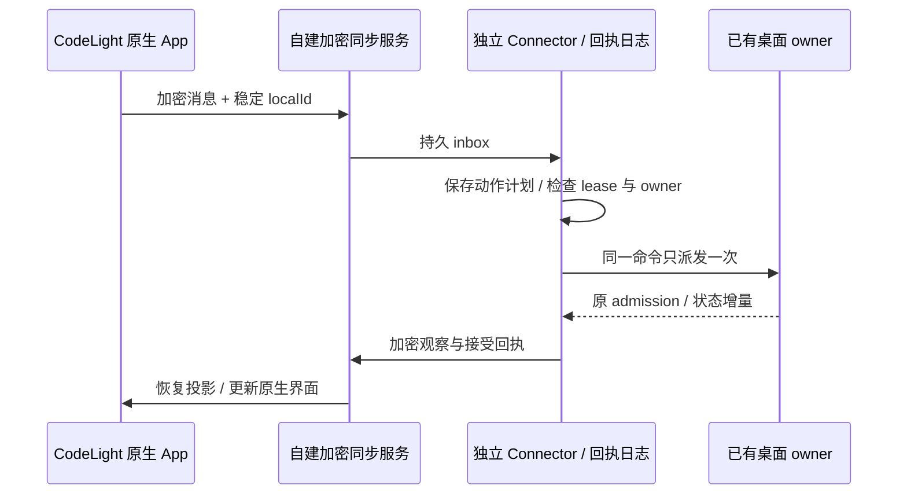

# CodeLight 产品与验收合同

2026-10-31 当前产品定位为 **Codex 专用原生手机 App**，只支持使用网关模式接入的桌面 Codex。其他 harness、窗口共享和 AX 控制是否启用留待后续决定。既有研究源码保留，但不属于当前发行能力。

## 产品规则与所有者

- CodeLight 基于本地 Happy MIT fork 的真实原生会话、工具、Markdown、附件与主题组件。App 名、原生 bundle、链接 scheme、启动页与设置统一为 CodeLight，保留许可证归属。
- 桌面 Connector 是观察者和转发者，Codex 原 owner 仍拥有原会话、运行时与 admission。Connector 不创建、恢复或重启原 Agent，不修改原应用源码、包、配置。窗口 ID、截图或 AX 控件不能冒充 Codex session ID 或原生会话协议。
- Mac App 内置加密同步服务、Connector 和出站隧道。本地独立数据目录保存配对密钥、加密检查点和操作摘要；手机凭据由原生安全存储拥有。
- 配对后 Mac App 默认显示实时及累计网关流量、HTTP/RPC 交互、在线设备和运行时长；通过“统计／扫码配对”切换内容。二维码续期保留当前选择，隐藏时不重新生成图片。详见 [Mac 统计页合同](codelight-mac-dashboard.md)。
- 正常首次使用只需打开 Mac App 并在手机扫描其二维码，不要求服务器选择、注册、匿名账号创建或 VPN。短期公网地址变化后重新扫描；公网使用 HTTPS，不能悄悄访问 Happy 公共服务。高级自建服务/诊断入口不改变正常扫码流程。
- 手机输入只有原 owner admission 才显示接受。断线、服务重启、未知回执保持稳定命令编号，不自动重发已经派发的动作。
- 原生集成发现：descriptor 尚未激活时 HTTP ACK 只代表进入中继。UI 和 Sync 双层要求普通 session 已 connected、非空 runtimeGeneration、steering=true 才能提交；所有非侵入手机 user 记录（包括缺 expectsAcceptance 的旧记录）hold 至 native accepted/rejected/unknown，明确排除原观察历史。Source activation banner 使用父 header 真实 top inset，不能被 glass header 遮挡，失败须可见。
- 实际 Native async question 只有 communications form、没有可关联内联 AskUserQuestion 卡时，即使有 choices 也必须展示 fallback banner/modal。只在明确存在可渲染且同 toolUseId/id 的内联卡时排除，不能按“有选项”假设内联卡必然存在。保留原 form question IDs、options 与 free-text，用户显式 Submit 后发送原 communication/question identity，点击选项不自动提交。
- 当前待回答的 fallback 提示独立于手机浮动输入区的状态淡出。用户阅读较早历史时，新问题仍必须可见、可打开；不能因为 `isChatAtBottom=false` 而同时隐藏提示并禁止触控。其他状态区、滚动按钮、输入草稿及原 question 所有者不变。验收包含在较早历史位置收到新 communication、打开表单并选择、显式提交一次、原 owner 回答/退役后移除提示；开发预览 `/dev/agent-question?history=1` 用于核对滚动历史时的固定提示和原生表单。
- 非 prefix 文本修订按 sourceRowId/revision 替换原片段，工具中途输出保持 running；只在原工具终态后显示完成。
- 手机底部只催当前轮未回答的问题；旧轮问题保留真实历史答复证据，不重新进入待操作队列。过期回复在 native dispatch 前拒绝，详见 [Codex 原生 IPC 合同](codex-native-ipc.md)。
- 项目视图在手机前台显示来自原 Codex 状态的轻量活跃/待操作统计，每条可见会话显示活跃、待操作、空闲或未确认状态。最近更新时间不是运行状态；未确认、过期或断连的数据不能显示为已确认的零。状态同步与当前会话的历史同步分开，详见 [项目状态合同](codelight-project-activity.md)。
- 原生项目内会话通过一行选择框切换，沿用已有项目归属、会话身份和路由。打开选择框不加载所有历史、不向原 Agent 发命令；重复选择当前会话保留输入草稿。
- 用户界面说明和翻译统一遵守 Codex-only 范围。不能用保留的 Happy/Claude/其他 harness 代码或历史 spec 宣称当前支持。

## 构建边界

本产品是用户明确要求开发并在模拟器测试的独立 fork，CodeLight 本地编译与测试针对当前源码。上游 Happy 的 EAS/OTA/商店发布流程属于上游产品发布；本轮不运行这些流程。独立产品输出需有对应的源码版本、构建标识、校验和及验证报告。

## 验收

完整网络验收包含当前 Mac App 的内置同步服务、出站隧道、Connector 和原生手机 App。Codex 桌面须已运行；发现和观察只绑定既有原 owner，绝不新建同会话 writer。类型/单测、模拟器、真机安装、网络可达与温度/帧率分别记录，不能互相代替。

1. 打开独立 Mac App，手机扫码完成配对，连接已经运行的 Codex 原 owner，读取真实专用验证聊天。
2. 原生界面显示 CodeLight、历史和工具；原输入、停止、问题/权限回应只作用于所见原会话身份。常规 UI、状态和恢复验收不发送新模型测试输入。
3. 字符增长、非 prefix 修订、工具输出、重复消息、Connector 重启和 App 重启正确恢复，不重复 native dispatch。
4. 图片点击打开、缩放、平移、关闭；附件只经源绑定加密链路提供，错误可见且可重试读取。
5. 前台项目状态、会话选择框和语言切换通过对应回归与原生验收；历史多 harness/window spec 不计入当前支持清单。
6. 提供可重建的源码、启动命令、本地模拟器包与当前验证报告，准确列出尚未验证的平台或能力。

