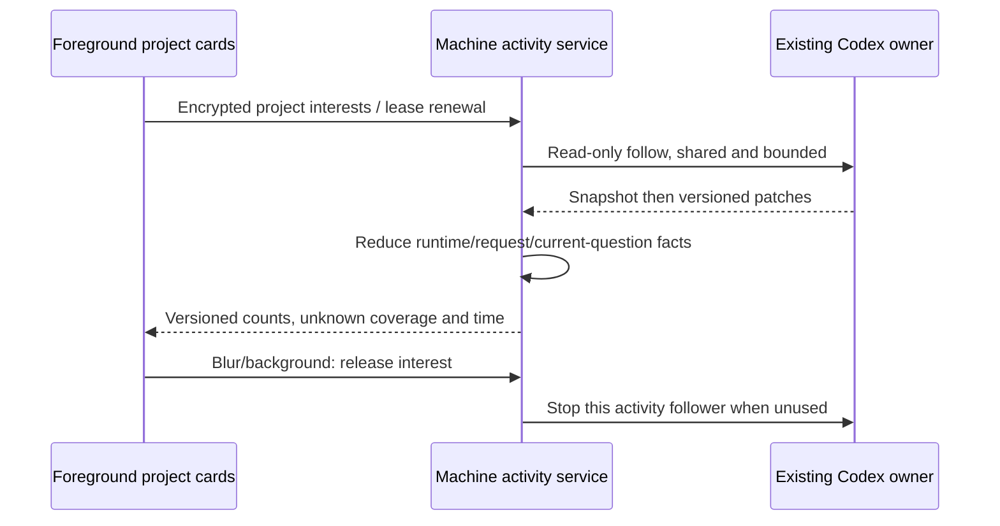

# CodeLight Codex project activity

## Product and owners

CodeLight currently serves native Codex desktop sessions only. Other harness and
window adapters remain historical/deferred source; the current discovery, restore,
selection and phone catalog exclude them without deleting saved history.

The original Codex owner/follower stream is the runtime authority. The index owns
project membership and titles, not running status. A separate read-only activity
observer derives small summaries; it never starts a runner, opens a desktop chat,
answers a question, or publishes conversation history to the phone.

## Counters and unknown states

- Active counts sessions whose native runtime status is `active`, including
  background work reported by that owner.
- Waiting counts sessions with a native pending request, a native waiting flag,
  or an unanswered asynchronous question in the current/latest turn. Previous
  turns follow the accepted current-turn question rule and do not reappear.
- These counters are independent: an asynchronous question can coexist with work.
- Missing owner, missing/unsupported native state, snapshot/patch gaps, owner
  generation changes and lost connection produce unknown status, not idle/zero.
- A project reports total, confirmed active, confirmed waiting and unknown counts.
  Resource-limited or unowned sessions remain visibly unconfirmed. Counts never
  claim complete coverage while unknown is nonzero.
- Search filters titles; project activity still describes the whole project.
- A valid partial summary renders its confirmed counters immediately, alongside
  the unknown count and refreshing state. It does not hide all useful counts
  until every cold owner lookup finishes.

## Foreground and payload contract

The phone requests activity for project cards while its project screen is focused
and the app is foreground. Requests contain a stable client ID and at most 16
project descriptors (`id`, `projectKey`, `hostId`) and a monotonically increasing
`requestSeq`. A release reserves its sequence before asynchronous scope checks;
older polls or releases cannot replace newer foreground interests. The machine
retains bounded release sequence tombstones beyond its maximum RPC wait window.
The authenticated machine scope
owns source membership. An empty descriptor list releases that client's interest.

The machine exposes read-only `codelight-project-activity` RPC. Replies have
`ok`, `version: 1`, a process epoch, monotonic sequence, observed time and project
summaries. Summaries contain only the requested UI ID, counts and availability.
No messages, tools, reasoning, file content or answer text appear in this payload.
UI IDs are bounded to 8192 characters, project keys to 4096 and the entire
normalized request to 256 KiB; long scoped workspace names keep their identity.

Polls are serialized, normally ten seconds apart, and back off after failure.
They stop in background or on blur. Mac interests expire after thirty seconds;
observers are shared across phones and bounded. The existing encrypted RPC and
owner lease protect transport. Unknown writes are never retried by this path.

The current Codex protocol provides an initial owner snapshot plus incremental
patches, not a separate public summary read. The activity observer reduces that
local stream to a small replica, ignoring tool/text changes and preserving native
question IDs and accepted reply evidence. The phone receives summaries only.

## Locale and compatibility

All ten registered phone languages receive CodeLight product and activity text.
Saved preference wins over native locale; region/script Chinese tags resolve to
the supported locale. Missing or invalid translations fall back to English.
The home screen supplies a direct language entry. Language changes do not modify
the original Codex application or its model configuration.

Legacy Codex catalog records without a control mode keep the local fallback;
explicit window or unknown modes and foreign harnesses are excluded. Archived or
removed index entries are hidden by catalog availability metadata while their
encrypted history remains. An unavailable index cannot mark every record removed.

The source registry owns `nativeSession.catalogueAvailable`: registration and a
successful rediscovery set it to `true`; confirmed absence from a successful
Codex index scan sets it to `false`. The registry serializes metadata updates for
each binding and rebases conflicts on the latest encrypted server record. Removal
changes only this flag; rediscovery updates index labels while preserving other
native metadata, owner capabilities, controls, receipts and history. A durable
binding write succeeds before its in-memory metadata/version are advanced. Both
operations retain the original source identity, data key and synchronized record.
On a cold start the daemon reads registered bindings once, after the first
successful complete Codex index scan. `savedBindings()` is an asynchronous,
read-only scan of ordinary `hash64.json` files; malformed, pending, foreign and
non-Codex records cannot become current bindings. File names and both saved source
identities must match `sourceKey`. The caller rechecks account, server and machine
ownership before marking absent records unavailable. Later scans compare their
in-memory catalogs; they do not reread every saved binding. Index failure never
triggers this reconciliation.
The machine advertises `codeLight.codexOnly=true` and
`codeLight.projectActivityVersion=1`; all runner `cliAvailability` fields remain
false. The activity capability describes a read-only summary service.

## Acceptance

### Visible session row status

The project view also shows a status label on each visible session row. Active
and waiting can coexist; a confirmed nonactive/nonwaiting session is idle. A
missing original-owner state is unconfirmed, never inferred idle.

Project descriptors may include `sessions: [{id, nativeId}]` for visible rows,
bounded to 64 requested rows across one poll. The machine verifies both the native
ID and its bound phone session ID within the requested project/host. Replies
include only those rows' `id`, `known`, `active` and `waiting` booleans; no titles,
messages or tool content. Visible rows take priority within the bounded observer
budget, including when their project header has scrolled out of view.

This is additive to version 1: older project-only callers still work, and missing
row-status support is shown as unconfirmed. One shared foreground loop serves
both project counters and row labels; no per-row network poll is introduced.

Verify native snapshot/patch and owner generation boundaries, current question
retirement, unrelated large text deltas, shared-interest expiry, foreground-only
serialized polling, account/server scope switches and stale replies. Validate
count payload size against large native fixture content. Use independent native
UI fixtures and the installed phone; no new model prompts are required.
