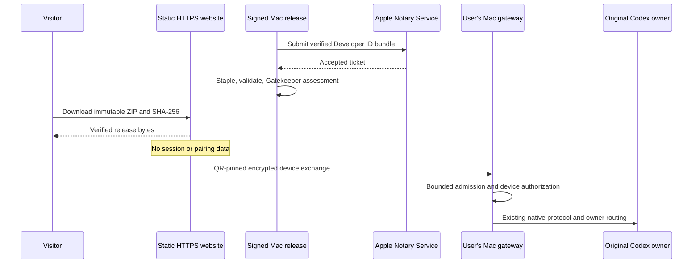

# Public source, Mac distribution and website

## Owners and scope

The user authorized public source at `https://github.com/mapix/CodeLight.git`
and a landing page with a notarized Mac download on the existing novarocks
Kubernetes cluster. The website is a static distribution surface: it must not
host pairing, session relays, account keys, private conversations or phone
development provisioning artifacts. Existing Codex owners remain untouched.

Publish a reviewed initial source snapshot without private development history.
Preserve the original local history. Include an MIT license, accurate upstream
notices, contribution/build/security guidance and reproducible release inputs.
Exclude upstream Google service configuration, credentials, local registries,
extracted applications, private QA and device-bound iPhone packages. Scan source
and the initial public Git history; checksum/test-vector exceptions must be
specific and explained. Dependency findings require remediation or a documented
reachability assessment, not a blanket claim that a scanner proves safety.

Public source, deployment examples and the final software archive must not contain
the publisher's saved private Relay server URL or hostname. Deployment examples
use `relay.example.com`; the installed app reads each user's saved configuration
outside its bundle. Compare the actual private configuration against selected
source files, reachable public Git history and every expanded release member,
including binaries. Keep matching values and audit captures private; public
reports contain counts and paths only. This check supplements secret scanning,
since a hostname may not match a credential detector.

The public source archive selects existing tracked and nonignored files only
inside the current standalone workspace's explicit source/configuration roots.
Deleted tracked files are omitted without reviving them. Refuse symlinks rather
than silently following external paths; exclude private state, network identity
and access-key files, generated dependencies/builds and obsolete prototype specs.
The v2 `connection-channels.json` file contains the saved Relay key and is
excluded by Git ignore, source selection and archive verification, just like
the legacy network access/identity files. A public source test must exercise
this filename with a private sentinel, not assume all JSON is publishable.
Use the same selection when creating the clean initial public Git snapshot.

## CI publication

The current GitHub publisher lacks the OAuth `workflow` scope. Publish the
reviewed CI configuration as `docs/ci/verify.yml`, without activating GitHub
Actions or requesting broader credentials. A repository owner can move it into
`.github/workflows/` when they choose to enable CI. Local release gates still run.

## Security release changes

Apply supported security fixes to bridge/relay dependencies and compatible
transitive patches. Development-only findings must be distinguished from code
in the shipped Mac bundle. Keep the native SDK line and original owner protocol.
The CodeLight mobile configuration is the default; upstream analytics, services
and OTA publishers must not activate on an ordinary source checkout.

The public gateway must bound connection count, request/header time and expensive
unauthenticated pairing admission. Invalid or exhausted pairing requests do not
call credential issuance. Authorized sync, revocation and original command
admission retain their owners. Lost credential exchange acknowledgments retain
the same key-bound response. Unknown cumulative traffic after storage failure
must remain unmeasured instead of displaying a invented zero.

Keep Expo 55 and its legacy image-size API compatible. Patch container-header
parsing so malformed ICNS entries cannot retain the same offset, and BMFF/JXL
zero-sized boxes consume the remaining input instead of looping. Validate
minimum headers and complete bounds. Run malformed inputs in bounded child
processes and retain valid image dimensions. Record patched package versions
honestly when advisory tools still match the old version number.

## Website and platform truth

Use the existing CodeLight brand with Chinese and English copy. The primary
action downloads the Mac release, with source/build instructions visible.
State gateway-mode-only Codex support, macOS 14+ on Apple Silicon, preview status,
and that the iPhone app currently needs source building rather than a public
device-bound IPA. Explain trusted-device access and temporary tunnel renewal.
Explain both public-access providers: Cloudflare Quick Tunnel addresses can
renew on restart; an authenticated Relay preserves its independent route across
reconnections. Phone setup remains the same QR flow, with no provider settings.
Performance numbers must identify host benchmarks; do not promise cool phones.
Use no analytics, external fonts or third-party scripts. Respect keyboard focus,
reduced motion and narrow phone layouts.

## Distribution gates

1. Secret/privacy review, source/production dependency audit and scoped regressions.
2. Bridge/mobile/production relay typechecks and root Lint.
3. Fresh Mac build, expected Developer ID chain and secure timestamp verification.
4. Apple Accepted result, stapled ticket validation, Gatekeeper acceptance.
5. Repacked archive integrity, published SHA-256 and reviewed release metadata.
6. Public source/license check and successful HTTPS page/download checks.
7. Kubernetes deployment in a dedicated namespace with a nonroot, read-only
   static container, dropped capabilities, no service-account token, bounded
   resources, readiness/liveness probes and network policy. Do not change other
   workloads. Validate server-side manifests before applying and verify rollout,
   certificate and external downloads afterwards.
