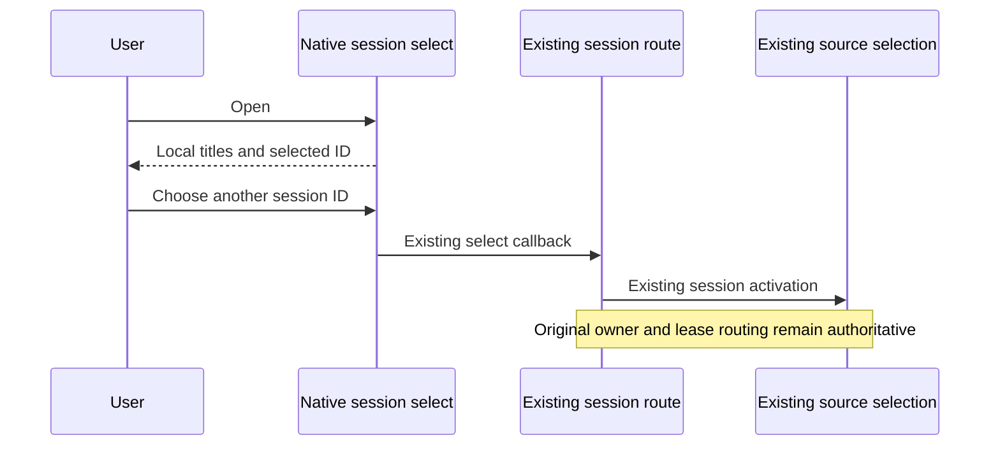

# CodeLight standalone project and finishing pass

The user requests a complete, standard standalone Git-managed project, after progressive loading and native model/effort controls are working. Worktree-specific controls are deferred; original project grouping still merges related worktrees correctly.

## Deliverable rules

- The project contains the complete active Mac supervisor/native UI, encrypted relay, original-session bridge and phone App sources, build scripts, targeted tests, specs and third-party license notices. Runtime dependencies and generated builds are reproducible and ignored by Git.
- Source migration preserves the previous workspace and unrelated local edits. Private credentials, native conversations, API keys, device registries, pairing invitations and private QA artifacts never enter the new repository or source archive.
- Git is initialized locally and the verified implementation is committed. No remote publication is implied.
- Branding uses the user's exact `gpt-image-2.5-flare` model. Brand outputs include an app icon, reusable mark/wordmark and connection/empty-state artwork as needed. Native small control glyphs continue to use appropriate system/vector icons. Generation provenance records the requested/actual model, prompts and output assets without credentials.
- Mac and phone use consistent branding, plain actionable error messages and loading feedback. A first scan presents incremental sessions, entering a session presents synchronization progress, and retry preserves unknown native command identities.
- Native model/effort controls use the original desktop owner, confirm settings updates, and show current supported choices. No substitute runner or original-App restart is introduced.

## Verification

Record build/typecheck/lint/targeted results, source/package secret exclusions and real native UI findings separately from fixtures. Reinstall updated Mac/iPhone artifacts only after sufficient checks, preserve the running original Codex agent, and report push/notarization limitations honestly.

## Portable build and source entry points

`pnpm build:mobile` resolves native files from this repository, irrespective of the caller's cwd, and requires an explicit device or simulator ID. Device builds require an explicit development team. Local trials use a checked-in entitlement file without APNs; simulator Keychain entitlement paths remain inside this project. Signing files and logs containing local identity stay outside source archives. The source verifier accepts the generated ZIP and uses the pinned pnpm workspace lockfile, current daemon entry point and source tree. Build failures propagate their real exit status.

Each workspace declares its build dependencies explicitly, including the phone's Expo Babel preset and the relay's Node WebAssembly API declarations; builds must not depend on the old monorepo's hoisting.

The explicit `--generic` device-build option uses generic/platform=iOS when hardware is offline; this changes only compilation targeting and retains the chosen team and provisioning. Device installation must still be verified separately.

An explicitly selected simulator builds its active architecture, preserving the
native UI target while avoiding duplicate simulator-architecture compilation.

## Native project session selection (2026-10-31)

- On the native phone/tablet App, the project conversation header uses one select
  box instead of a horizontally overflowing tab strip. It displays the current
  conversation title and a down arrow; long titles truncate to one line.
- The platform picker lists every conversation in the same project checkout,
  with full titles and the current selection marked. Existing checkout grouping,
  conversation ordering and pending-conversation handover remain authoritative.
- Choosing another item reuses the existing in-place route/session selection.
  Choosing the current item preserves its composer and does not navigate. Opening
  or dismissing the picker issues no native Agent command or history request.
- Existing header actions and the new-conversation button retain their behavior.
  The web tab strip is unchanged. The native control reserves a 44-point row and
  occupies the available width regardless of the conversation count.
- Regressions cover a large project, exact session identity, current selection,
  pending handover and the web control. Native QA opens the same selector with
  synthetic conversations, scrolls its menu and selects a distant item without
  attaching to or sending input to an original Agent.

