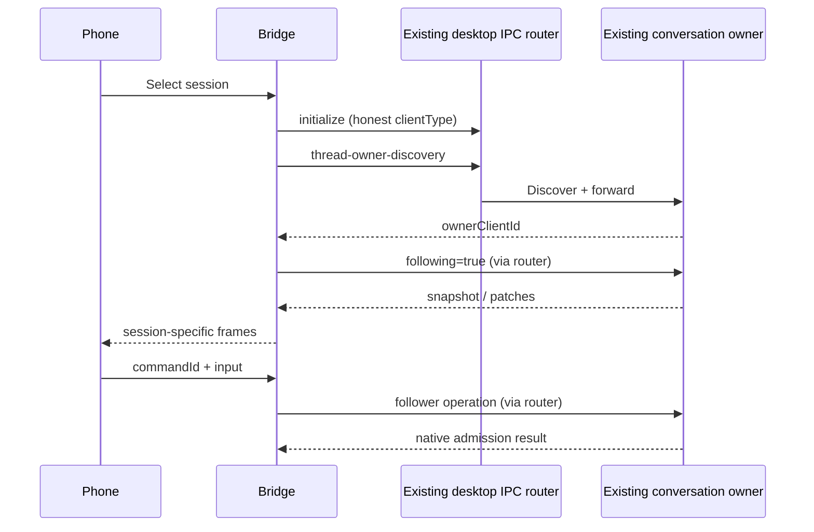

# Codex native desktop IPC adapter

## Product and ownership rules

The bridge connects to an already running desktop IPC router at
`~/.codex/ipc/ipc.sock`. It identifies itself as `agent-session-bridge`. The
desktop's existing owner remains responsible for the loaded conversation,
model calls, tools, queue, approvals and persistence. The adapter never starts
an app-server, resumes a rollout in another process, claims ownership, changes
Codex configuration or modifies the application package.



## Observed interface

2026-10-28 installed desktop bundled CLI: `0.164.0-alpha.11.1`.
The desktop app-server uses stdio; no local app-server control socket exists.
The separate desktop IPC router accepts an ordinary local Python client with
an honest `clientType`; initialize-only receipt is in
`research/codex/ipc-initialize-probe.json`. App Tools socket is a different
interface and rejects this ordinary client with
`untrusted-code-signing-identity`.

Evidence comes from packed JavaScript extracted without modifying the app:
`research/codex/extracted/.vite/build/src-Dl21kCYQ.js` (IPC router/client,
version table, owner routing) and `main-0FVbxCQU.js` (follower dispatch).
REA ASAR analysis reported an integrity mismatch in an unpacked native member;
the extracted JavaScript is ordinary static evidence, not verified execution.

## Transport and API

Frames are unsigned 32-bit little-endian byte length followed by UTF-8 JSON.
Reject empty frames, oversized frames, invalid JSON, unexpected response
methods and incompatible stream versions. Native maximum is 256 MiB; this
adapter defaults to 32 MiB and allows only a smaller/equal configurable bound.

Request envelope: `{type:'request',requestId,sourceClientId,version,method,
params,targetClientId?,hostId?,timeoutMs}`. Initialization version is 0;
response has `resultType`, `method`, `handledByClientId`, `result`.
Owner discovery version is 1, with `{hostId,conversationId}`. Local follower
requests omit envelope `hostId`; remote requests include it and add one to the
follower method version. No fallback to local routing is allowed.

Subscriptions send `thread-stream-following-changed` version 1 with
`{conversationId,hostId,following:true}`, targeting only the discovered owner.
Receive `thread-stream-state-changed` version 11, including snapshot or patches.
Only selected session IDs and the current owner source are forwarded. Remove
the subscription with `following:false`. The adapter never publishes a snapshot
or ownership event. Owner disconnection clears cached routing and rediscovers
only subscribed sessions. A newly connected IPC client retries missing owner
discovery for selected subscriptions, so a transient owner handoff can finish.
Disconnection fails pending operations; explicit
reconnection restores read subscriptions, but never replays mutation requests.

- `send(sessionId,text,commandId)`: follower-start-turn v2, with
  `{conversationId,turnStart:{request:{threadId,input,clientUserMessageId},
  context:{inheritThreadSettings:true}}}`. The original desktop owner executes
  its ordinary turn/start flow. The independent adapter must not force
  `useUserMessageAdmission`: that selects a cloud-only app-server extension and
  fails for local hosts with `User-message admission requires a cloud app-server host`.
- `steer(sessionId,text,commandId)`: follower-steer-turn v1, with
  `{conversationId,input,clientUserMessageId,restoreMessage:{context:{prompt,commentAttachments:[]}}}`.
  The installed owner's ADe handler dereferences restoreMessage.cwd and
  restoreMessage.context before dispatch; omitting restoreMessage caused the
  first dedicated runtime steer to be rejected. Omitted cwd/roots/model fields
  intentionally inherit the existing owner's settings. This is explicitly a command to
  the current active turn; native follower schema has no caller expected-turn
  field. It must not be presented as an atomic operation on a specified turn.
- `interrupt({sessionId,hostId,turnId},commandId)`: follower-interrupt-turn v4,
  `{conversationId,mode:'user-stop',expectedTurnId}`. A nonempty expected turn
  ID and matching host are mandatory; stale protection stays in the owner.
- `respondApproval({sessionId,hostId,requestId,kind},decision,commandId)`:
  command/file approval follower v1, `{conversationId,requestId,decision}`.
  Only native `accept`, `decline`, `cancel` are exposed. Owner validates the pending request identity.
- `respondUserInput(target,response,commandId)`: follower-submit-user-input v1.
  Exact native response is `{answers:{questionId:{answers:string[]}}}`.
- `respondElicitation(target,response,commandId)`: follower-submit-mcp-server-
  elicitation-response v1, with `{action:'accept'|'decline'|'cancel',content?,_meta?}`.
- `respondPermissions(target,response,commandId)`: follower-permissions-request-
  approval-response v1, with `{permissions:{network?,fileSystem?},scope?,strictAutoReview?}`.
  The three response methods require explicit matching host/session/request IDs
  and validate against JSON schemas emitted by the currently installed bundled
  CLI. These schemas are bundled with the independent adapter. No new runtime
  is started by schema generation.

Commands are keyed by session + commandId. Repeating identical input returns
the same promise. Reusing a key for different input fails. A timeout or lost
response is an unknown outcome and is never retried automatically, including
after disconnect. This in-memory adapter deduplication complements the server's
durable command store; it does not promise cross-process exactly-once delivery.

### Local send regression (2026-10-31)

The installed desktop rejected a phone send before allocating a turn ID when
the adapter forced cloud user-message admission. Its placeholder user row still
contained the client command ID. A placeholder without an original turn ID is
not evidence of accepted input. Observation-based receipts require a nonempty
original turn ID; pending rows without that identity retain an unknown outcome.
Previously saved nonqueued confirmations without a turn ID are invalidated on
connector load. Recovery never redispatches their saved commands.

```mermaid
sequenceDiagram
 participant P as Phone
 participant C as CodeLight Connector
 participant O as Original Desktop Owner
 P->>C: Input with stable local ID
 C->>O: follower-start-turn, inherit existing settings
 O->>O: ordinary turn/start
 O-->>C: Original turn/user identity
 C-->>P: Confirm matching input
 Note over C: No turn identity: retain unknown; query without replay
```

## Acceptance

Node tests with an independent mock Unix socket must cover fragmented frames,
initialize/version/request correlation, owner discovery and targeted follower
routing, session filtering, version/size rejection, disconnect rejection,
reconnection and mutation deduplication (including unknown outcomes). Real
user conversations receive no test input or approval decisions. Before claiming
full runtime acceptance, a dedicated desktop-owned test conversation must show
subscription and native admission, with app-server PID unchanged.

## Phone-facing backend projection

`CodexBackend` wraps the IPC adapter. Per selected session it owns one native
subscription, a private snapshot base and its revision, and a reference count
shared by `snapshot()` waiters and `subscribe()` consumers. The final release
unsubscribes and erases the cached native state. Every consumer receives its
own cloned view; a consumer cannot mutate another consumer's snapshot.

The phone view contains only `rows`, `currentTurnId`, `status`, `requests` and
`revision`. Rows are ordered through canonical history islands and
`entitiesByKey`, falling back to loaded `turns`. Text and tool display fields
are copied through explicit allowlists. Developer instructions, configuration,
environment values and the raw owner state never leave the backend. The view
contains only history loaded by the existing owner; persisted history remains
the separate storage layer's responsibility.
Reasoning rows contain only the native item's public `summary`; raw `content`
and `text` are never used as fallback. Summary is a separate row role intended
for a collapsed display, not normal assistant answer text.

Snapshots validate every incoming field, then reconcile unchanged private
branches only within the same verified owner generation. See
[native projection work budget](codex-native-projection-performance.md).
Immer patches use array paths and apply
atomically through a private path-copy transaction; patch operation/path/value validation rejects
`__proto__`, `constructor` and `prototype`, inherited paths, invalid array
indices and unsupported operations. A missing base or mismatched baseRevision
invalidates the live projection and renews only the read subscription. Owner
loss and disconnection also invalidate the base. Write requests are never
replayed as part of recovery. Snapshot APIs wait for a fresh owner state before
resolving; invalidation views clear currentTurnId and actionable requests.

Command payloads are exact: send/steer `{text}`, interrupt `{turnId}` and
approval `{kind,decision,requestId}` for command/file, or
`{kind:'user-input'|'permissions'|'elicitation',response,requestId}` for the
other native responses. Every response requires a matching current native
request. User-input answers must cover the requested question IDs only.
Permission grants cannot exceed the permissions offered by that pending
request. MCP accepted content must validate against the pending form schema;
the original owner's MCP safety check still runs. The projection includes
only allowlisted form/schema and permission fields needed for the decision.
Unknown request kinds stay non-actionable. `openai/userVerification` accepts
only the original OS-protected verification flow; the phone can decline or
cancel but cannot manufacture acceptance. Unsupported form schema versions or
keywords are reported explicitly. Native interruption retains the submitted turn ID.

Mutation timeouts and disconnects are reported as `delivery-unknown`, so the
outer command receipt does not label a possibly accepted command as failed and
encourage resubmission. Successful responses expose only action acknowledgment
and allowlisted admission metadata, never an arbitrary native response object.

Backend tests cover two consumers sharing one subscription, independent views,
first-snapshot waiting, canonical ordering and sensitive-field exclusion,
Immer changes and unsafe paths, revision mismatch recovery, disconnect base
invalidation, exact payload/request validation and unknown delivery mapping.

### Approval display and schema roundtrip (2026-10-28)

The installed aggregate v2 schema and individual response schema agree:
filesystem paths are `{type:'path',path}`, `{type:'glob_pattern',pattern}`, or
`{type:'special',value:{kind,...}}`. Special kinds are `root`, `minimal`,
`project_roots` (optional nullable `subpath`), `tmpdir`, `slash_tmp`, and
`unknown` (required `path`, optional nullable `subpath`). A string `special.value`
is not a legal variant of this installed version and is not silently supported.

Permission display preserves all legal path variants and explicit nulls in
network/fileSystem, enabled, entries, read/write and subpath. Its projected
profile must itself validate against the native permission response schema
before it is advertised as grantable. Malformed/future variants are visibly
unsupported; arbitrary extra params and metadata are excluded. The permission
request displays the native grant scopes `turn` and `session`, with default
`turn`, and grants continue to be constrained to the pending requested profile.

File request params contain `itemId`, `turnId`, `reason` and optional `grantRoot`,
not the actual edits. The backend finds that exact loaded file-change item and
copies path, change kind, move destination (`move_path`) and diff through an
allowlist. Missing edits permit decline/cancel but do not advertise acceptance.
A grantRoot is labelled a requested session root; the installed schema itself
says whether it is honored is unclear, so the bridge makes no stronger claim.

Command approvals display command/stdin distinction, command actions, working
directory and native network context (`host`, `protocol`: http, https,
socks5Tcp or socks5Udp). Proposed network/execpolicy amendments are display
context, not automatically granted policy changes. No raw approval params,
environment variables or authentication metadata are included.

Regression fixtures are authored independently of the projector and checked
with the bundled generated JSON schema. They enumerate every special kind,
ordinary/glob paths, nullable and omitted fields, and demonstrate that a
projected full grant is still a valid native response. Separate fixtures verify
file item association and network protocols, including absent details and
excluded metadata. Runtime writes remain untested until the user authorizes a
dedicated test chat.

### Explicitly authorized native runtime gate

Historical acceptance used an explicitly authorized original-desktop-owned
dedicated test thread, with protected parent sessions and exact process/file
boundaries. That authorization and the environment-bound harness were private
to the original acceptance run. They are not included in the public distribution
and do not authorize model prompts from a new source checkout.

The private harness read HTTP client credentials without printing them,
obtained the current bridge instance, and verified native HTTP
send + same-commandId duplicate delivery with a unique echo marker. It observes
the dedicated session's native event stream and requires one assistant echo,
one admitted test command and visible native user input. Resume rechecks saved
command receipts rather than resending uncertain requests.

The stream phase asks the unchanged model/provider/permissions to run a short
test-owned Python script in the dedicated directory. It prints its own PID and
two stream markers with sleeps between them. After observing the first marker
and multiple native revisions, the gate stops only the explicit current turn
ID and verifies native completion and unchanged protected app PIDs. Any test
child surviving interruption is cleaned only after exact PID + unique script
path + working directory checks. Sanitized evidence contains markers, counts
and receipt state; private process identities, cookies and personal chat bodies are
never included. No other chat is sent input or interrupted.

Native user display uses explicit userMessage items where available, and the
turn's public params.input only when no opening userMessage exists. Empty input
is not replaced with unknown tool output. The initial READY bootstrap has empty
params.input and a functionCallOutput item, so it is not invented as a user row.
Uncorrelated functionCallOutput bootstrap content remains hidden. A pending
public input row is removed when its explicit opening userMessage arrives.
Native `steeringUserMessage` exposes only its public input and delivery status;
restoreMessage context is never projected. When a matching server userMessage
exists, serverUserMessageId/clientUserMessageId correlation prevents duplicate
rows for the same accepted steering input.
The runtime script can resume known complete receipts without replay and
accepts an explicit `--new-stream-attempt` only after a failed/complete previous
attempt and a confirmed dead test child; it preserves prior attempt evidence.

### Native silent output refresh

The installed owner's `applyOutputDeltas` and file `patchUpdated` handlers
explicitly set `broadcastPatchesToFollowers:false`. This suppresses stdout/file
edits on the follower IPC push path even though the owner stores those updates.
`acceptedTextChanges` is transcript optimization metadata for changes already
present in normal Immer patches; replaying it as a second delta would duplicate
text. The first two runtime attempts retain evidence of the resulting gap.

The independent backend therefore renews the existing follower's
`following=true` at most once per second only while a selected, subscribed
session is active and has an in-progress commandExecution or fileChange item.
The existing owner responds with its current read-only snapshot; this does not
start/resume a runtime, claim ownership, retry a command or change app config.
An incomplete active state allows at most five conservative refreshes per turn.
Idle, closed, disconnected and unreferenced sessions cancel the timer immediately.
Owner generation checks discard stale refreshes; there is only one timer per
session regardless of phone consumer count.

These snapshots can contain new output with the same native revision. The
backend replaces and publishes them without inventing a larger native revision;
its independent `contentStamp` hashes only the allowlisted phone view so clients
can distinguish changed display content. Runtime evidence must observe the
first stdout marker while the test child is alive and before the second marker,
then verify steer and explicit-turn stop. The refresh count/event rate and
process CPU/RSS sampling are part of the bounded runtime gate.

The actual code-mode tool returned each first stdout marker to the model about
1.165 seconds after `exec_command(yield_time_ms:1000)`, while hosted-owner
conversation snapshots did not contain those bytes until process completion.
Snapshot serialization is a plain object copy; no omitted external transcript
buffer has been found. This distinguishes timely model tool results from the
public rich command card state exposed by this interface. The exact desktop
card behavior remains subject to UI comparison; the bridge must not claim
stdout streaming passed merely because snapshots or native revisions changed.

`--gate=control` retains `stdoutGatePassed:false` and instead verifies two
distinct public assistant progress markers and actual native command-inProgress
state while a test-owned PID receipt confirms the exact process is alive. The
receipt contains only PID, run marker, cwd and start timestamp. It is an
isolated test artifact, not a source of fabricated application output. Steer
and explicit-turn stop then test the original owner's control path. Public
progress changes must occur before work ends; event counts alone do not pass.
Optional independent-service diagnostics may be enabled with
`BRIDGE_CODEX_ERROR_THREAD` and `BRIDGE_CODEX_ERROR_FILE`. They record only that
explicit test thread's native error code/message, action and command ID into a
private file. No request payload, cookies or authentication fields are recorded.
An independent failed steer gate does not prevent testing explicit-turn stop;
the runtime runner records steer failure, stops the still-active dedicated turn
and cleans only its verified test child. Overall completion still requires the
steer/admission gate to be resolved; failed gates are never relabelled passed.
Foreground identity comes only from an in-progress native turn. A thread's
aggregate `threadRuntimeStatus:active` can also reflect background work and
must not manufacture currentTurnId from a completed turn. The phone's stop
identity therefore never falls back to the most recent completed turn.
The controlled active test explicitly awaits a long write_stdin tool call after
its public running message, rather than ending the foreground model task while
leaving a terminal alive. Immediately before control it records only the test
scope's native turn status, request methods and aggregate activity flags.

The dedicated active steer diagnostic confirmed
`Cannot read properties of undefined (reading 'length')`. The installed owner
`rr(textInput)` directly reads `textInput.text_elements.length` before calling
the app-server. The generated native UserInput schema declares `text_elements`
with default `[]`, so normal app-server start/admission fills it, while the
follower-to-owner steer path must supply that normalized default itself. Plain
phone text inputs now include `{type:'text',text,text_elements:[]}` for both
send and steer. No annotations, cwd, model, provider or permissions are added.
The owner simulation regression reads the actual `text_elements.length` path
before acknowledging steer, rather than merely echoing the adapter payload.

### Native asynchronous questions

The dedicated model's retained additional_tools definitions contain
`functions.request_user_input_async` in Default mode. Its contract returns
immediately and delivers replies as new user messages; the synchronous
`request_user_input` declaration is restricted to Plan mode. This async path
must not be represented as `item/tool/requestUserInput` or a pending approval.

The shipped native reader derives the question identity exactly as
`JSON.stringify(['request_user_input_async', agentMessage.id, questionIndex])`.
It recognizes user text wrapped in `<send_user_message_question_reply>` and
`</send_user_message_question_reply>`, containing a JSON object or nonempty
array of `{questionItemId,question,answer}`. Reply text enters the existing
user-message admission; it is not a tool response or manufactured requestId.
The private restore/input handling from the completed control gate stays unchanged.

A single newly authorized preference-question sample in the existing dedicated
chat will capture the actual public item structure before projection is extended.
Only its public question title/options and original item identity are exposed.
The answer sample uses the native marker format and existing send admission;
source fields are kept separate from blocking request/user-input contracts.

The actual sample produced an `agentMessage` whose id was
`call_oWxTJq3U0QkGwVdyS1JT8cuw` and whose public questions were
`[{title,options:['BRIDGE_CHOICE_A','BRIDGE_CHOICE_B']}]`. The packaged renderer
maps each question to `{id,sourceItemId,questionIndex,title,options}` and builds
the reply with newline-delimited native markers. Row `asyncQuestions` preserves
that exact identity formula, original message id, index, title and option order.
Accepted native user/steering reply items mark only the matching question
answered. Pending or interrupted optimistic steering does not count as an answer.

### Phone async-question scope (2026-10-31)

The user accepts that the phone's bottom prompt includes only unanswered questions
from the current foreground turn, or the latest loaded turn when no foreground
turn is running. The native view publishes `latestTurnId` from the ordered loaded
turns. Earlier questions keep their real answered/unanswered evidence in the native
history, but cannot re-enter the phone's pending communication map. An empty newer
turn also retires older prompts; resolving the latest question must not fall back
to an older unanswered one. Blocking native requests remain governed by the owner's
request list. A fresh phone answer to a retired question is rejected before dispatch;
existing command/receipt identities retain their previous outcomes.

```mermaid
sequenceDiagram
    participant Owner as Original Codex owner
    participant Bridge as Mac question projection
    participant Phone as Phone pending forms
    Owner-->>Bridge: Ordered turns, current turn, accepted replies
    Bridge->>Bridge: Derive latestTurnId and current unanswered questions
    Bridge-->>Phone: Replace communication map at a new version
    Owner-->>Bridge: Answer accepted or a newer turn starts
    Bridge-->>Phone: Remove answered or retired question keys
    Phone->>Bridge: Late answer with old key
    Bridge-->>Phone: stale-question; no native dispatch
```

`answer-question` command payload is exactly `{questionItemId,answer}`. It
requires a loaded unanswered native question in this session, builds the native
`{questionItemId,question:title,answer}` text packet and calls existing send.
Unknown/stale question IDs are rejected before admission. Free text is allowed
even when suggested options exist; no option is submitted without a click.

### Phone request forms

The renderer must assemble JSON values of the requested types before native
validation: local JSON Pointer refs, defined nested objects, titled const enums,
enum arrays and general typed arrays, nullable fields, decimal numbers and
explicit schema defaults. Decimal controls use step=any, integer controls use
step=1. Unsupported/cyclic/remote schemas show a desktop continuation path;
they must never silently become text inputs and submit a wrong type.

Every submit handler enforces operable and allowedActions, keeps failures
recoverable and prevents duplicate clicks. URL parsing cannot abort sibling
request rendering. Suggested question options always retain a free-text Other
answer; native async questions use answer-question, blocking questions retain
the existing question-ID answer-map contract.

Permission summaries display every special path kind, subpath and glob depth.
Command stdin prompts are distinct from execution prompts. File grantRoot and
its native uncertainty are shown with the file diff summary. The response
profile remains unchanged by presentation.

Happy DOM tests execute actual form submission and validate assembled payloads
against the current native response/requested schema, including multi-select,
refs, nested values, defaults, invalid/unsupported forms and native async reply
identity. UI tests do not send model prompts or modify either installed app.

## 历史聊天尚未存在 owner

2026-10-29 实测：原 Desktop 进程更换后，专用聊天可能存在于历史但
owner discovery 为 null。通过系统正常打开 `codex://threads/<真实UUID>` 后，
原 Desktop 导航至已有聊天，约 2 秒后 discovery 返回其 owner；没有创建
另一个 app-server 或发送输入。立即 discovery 仍可能为 null。

新增显式 `open-desktop` 操作，payload 必须为空对象，local host 且聊天 ID
为 UUID。它仅请求 macOS 正常 URL handler 打开原 Desktop 的已有聊天，
回执标记 requested，不宣称 owner 已可用。手机继续只读刷新确认 live。
不得隐式打开聊天、伪造 caller、修改配置或恢复成新的 runtime writer。

## Native 输入关联

公开用户行可包含 `commandId`，仅来自原 native turn.params.clientUserMessageId、
userMessage.clientId 或 steeringUserMessage.clientUserMessageId。它用于 Happy
通信记录与原 admission 的精确关联，不按相同文字猜测作者或去重；没有原生
关联字段时不生成命令身份。不扩大正文、工具参数或推理可见性。
