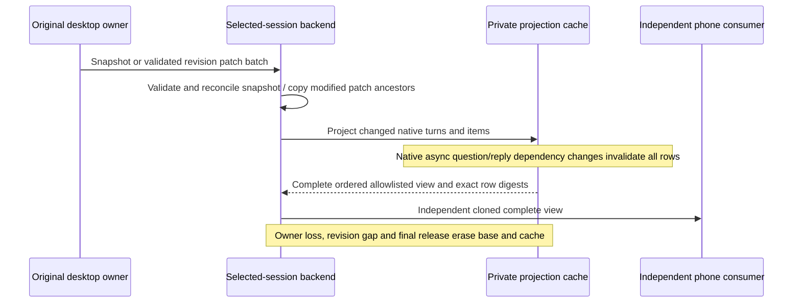

# Native projection work budget

`CodexBackend` retains the original desktop owner, revision admission and private
JSON base described in `codex-native-ipc.md`. This optimization changes the
observer's local work; it does not change native routing or phone history.

## Owners and cache lifetime



## Rules

- First snapshots are independently cloned. Subsequent snapshots from the same
  owner validate every incoming JSON value/key and reconcile exact unchanged
  branches against the private base. Source objects never enter the base by
  reference. This also applies to same-revision snapshots emitted for silent
  tool output: unchanged branches retain their row cache, changed output is
  completely represented. Owner changes start a new base/cache.
- Patches copy only modified containers;
  untouched private JSON branches are shared. Each batch remains atomic: a later
  invalid patch or invalid later snapshot field must leave its previous base and projection unchanged before
  ordinary invalidation. Paths, operations, inherited properties and JSON values
  retain the existing rejection rules.
- History ordering is canonical. Unchanged native turns and items reuse their
  allowlisted rows. Turn status, timestamp, identity, item position fallback,
  steering aliases and duplicate IDs retain their existing effects.
- Metadata-only patches reuse the ordered rows without walking their items.
  A changed tool output reuses unrelated native items. Pending opening input
  and steering aliases are reconsidered inside the affected turn because a
  newly accepted user item can replace or rename those rows. Assembling changed
  ordered rows may still copy the row-reference array.
- Native asynchronous questions and accepted marker replies have dependencies
  across turns. Addition, replacement, removal or reordering of those dependency
  records explicitly rebuilds the full question/answer projection. Ordinary
  tool/status updates reuse the existing dependency index.
- The stamp is a versioned SHA-256 composition of exact JSON row digests in
  order, plus every remaining projected field including revision and owner
  generation. Cached digests avoid serializing unchanged history text. The stamp
  is an equality token, not a SHA-256 hash of the previous monolithic JSON format.
  No truncated text, sampling or approximate hash is used.
- Requests are reprojected when their source or related history changes;
  response authorization continues against the current complete native view.
  Consumer isolation remains an independent complete clone. Publishing to
  consumers therefore still costs work proportional to the public history.
- Refresh scheduling uses cached turn/tool summaries, retaining the existing
  original-owner read refresh behavior and limits.

## Acceptance

Use synthetic canonical and fallback long histories. Verify untouched base and
row identity, metadata-only zero row work, one-item tool updates, exact stamps,
consumer mutation isolation, late-batch rejection, array shifts and root
replacement. Compare incremental output with a fresh full projection for
question/reply changes, duplicates, steering aliases and turn metadata changes.

Measure the complete backend receive/publish path against its saved previous
source, using identical long states, patches and full same-revision stdout
snapshots. Record Node version, source
hashes, history size, elapsed/CPU/allocation evidence and the remaining consumer
clone cost. Host measurements do not establish connected-iPhone energy or
thermal behavior.

## Recorded host measurement

The [synthetic benchmark record](../test/performance/codex-native-projection-20261031.json)
uses Node 24.15.0, 1,000 canonical turns, 20,000 public rows and a 26,548,417-byte
state. Each case performs 40 updates with an independent full consumer clone.
The snapshot case additionally decodes the full JSON state each time.

| Case | Previous CPU | Current CPU | Reduction |
| --- | ---: | ---: | ---: |
| stdout patch | 7,590 ms | 2,991 ms | 61% |
| status patch | 7,624 ms | 2,308 ms | 70% |
| same-revision stdout snapshot | 10,840 ms | 5,811 ms | 46% |

The current stdout cases project 40 items and serialize 49,070 row bytes across
all 40 updates; status patches project/serialize none. The record includes
source hashes and observed heap data. Heap peaks remain substantial because
complete consumer clones and full snapshot JSON decoding remain in the path;
these measurements are not cumulative allocation totals or phone thermal
measurements.

Run the benchmark explicitly with an archived previous backend source:

```sh
CODELIGHT_NATIVE_BENCHMARK=1 CODELIGHT_NATIVE_BASELINE=/path/to/previous-codex-backend.mjs node --expose-gc --test --test-name-pattern='synthetic complete' test/codex-backend-performance.test.mjs
```
