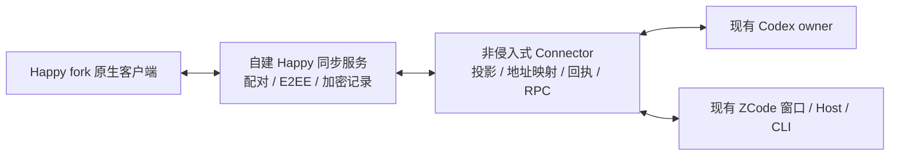

# Happy 为基础的原生客户端与同步方案

> **历史方案（2026-10-31）**：本文件保留此前的多 harness、窗口、传输或旧工程交付方案，不是当前发行能力或操作入口清单。当前 CodeLight 是 Codex 专用原生手机 App；其他 harness 是否启用留待后续决定。当前工程、命令和交付规则以 [产品合同](codelight-product.md)、[单独工程合同](codelight-standard-project.md) 和 [构建说明](../docs/BUILD-AND-VERIFY.md) 为准。

## 用户最新决定

2026-10-29 用户拒绝当前独立手机 UI，要求整个方案大幅借鉴 Happy，唯一必须
保留的区别是桌面接入非侵入。真机签名安装暂缓，优先持续在模拟器中验证。
这覆盖旧 UI 的视觉方案及先安装真机的下一步；原桌面应用不可修改源码/包、
不可重启工作进程、不可恢复成第二个同会话 writer 的要求保持。

## 基线

Happy upstream：`https://github.com/slopus/happy`，MIT；基线 commit
`ee5ccff79b046570dc7e62eeec90e7c8a9d7027e`。本地 fork 位于 `clients/happy/`，
分支 `codex/noninvasive-bridge`；`research/happy/` 为只读参照。没有创建 GitHub
远端 fork 或发布资源。修改前读取 fork 本身适用的工程规则。

## 复用边界

- 客户端优先使用 Happy 的真实会话列表、SessionView、消息/工具/Markdown、
  AgentInput、附件、图片、菜单、导航和主题实现，保留 MIT 声明。不能以只换
  颜色或重写一套近似卡片冒充 fork。
- 自建同步服务优先采用 Happy 的 standalone/self-host、配对和 E2EE/消息恢复
  契约；其 PGlite 和本地上传可用于本地验证。默认隔离数据目录与端口，不能
  写已有 Happy/Codex/Claude 用户配置或自动启动 Happy model runners。
- 桌面 Connector 复用已经验证的 `CodexBackend` / `ZCodeAxBackend`，向 Happy
  同步层提供既有 runtime 的观察投影与指令回传。可复用 Happy SessionClient
  的加密传输和 RPC，不能复用会创建/恢复新 Agent 的执行路径。
- Happy 的会话记录与加密通信日志不是原 runtime 的 admission。原命令以稳定
  localId/commandId、原 native address、runtime/turn generation 进入旧 receipt
  与 owner 路径；未知结果与重连不盲重放。缺失能力由 capability 明确说明。

## 首个必须完成的贯通切片

1. 本地自建 Happy 同步服务与 fork 客户端原生模拟器运行，使用隔离测试身份。
2. Connector 注册一条已授权验证聊天对应的 source 映射；不启新 app-server。
3. Happy 原生 UI 读取原聊天、显示实时消息/工具、发送到同一 owner、停止及回应
   问题；检查重复/重连不产生第二副作用。
4. 图片缩略图与全屏预览、缩放/退出、加载/错误状态真实操作；Markdown图片、
   本地附件/工具图片与窗口截图来源必须按当前 source 绑定鉴权，不能开放任意路径。
5. 按 Happy 真正的排版/字体/间距/导航与 UE 在相同模拟器尺寸截图对照。保留
   已知协议/GUI能力限制的真实说明，不能用假消息填出上线能力。

旧 `mobile/` 和其交付包暂作已验证 transport/行为基线，不再作为最终 UI 完成
声明。Happy fork 贯通后更新交付说明和打包入口，再继续完整目标审计。
