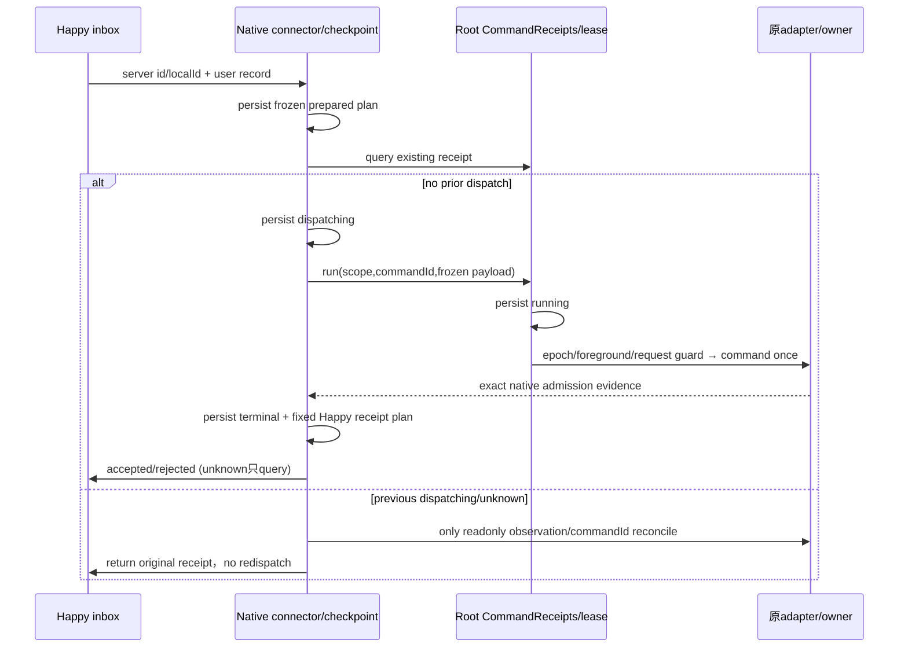

# Happy Native Connector（单source）

> **当前发行范围（2026-10-31）**：本共享 connector 合同用于 Codex 原生 session。下文保留的 window/其他 source 分支属于延期研究，不表示当前 CodeLight 已启用其他 harness；原生会话能力以 [当前产品合同](codelight-product.md) 为准。

## 所有者

Root负责source binding/key/bootstrap、proper-lockfile进程lease和加载CommandReceipts。本模块只调用传入original adapter的snapshot/subscribe/command，不导入runner/commonhandlers，不读credentials，不新建原SDK进程，不模型/GUI测试。

Constructor：`{transport,adapter,nativeId,sourceIdentity,bindingId,metadata?,receipts,statePath,encryptionKey,getGeneration?,assertLease?,leaseRequired=true,admissionTimeoutMs=5000}`。`start/close/project/processInbox/status`。statePath由该connector独占，async原子/fsync写入AES-GCM加密checkpoint，source/Happy/key身份严格绑定。

## Native输入唯一写入路径

Happy完整outer id/localId/seq + plaintext .record进入验证。own-publisher或role=session观察历史、agent输出均不能变native输入；仅真实peer role=user/text。commandId固定hash(bindingId/localId/action)，缺localId使用固定server id；选择send/steer、payload、source epoch只在首次计划时定稿，不能重启后按新状态换action/id。

计划先durable prepared，再durable dispatching，再CommandReceipts.run（其running先落盘）才original adapter.command。重复/已处理complete、failed、unknown返回原receipt；恢复dispatching无receipt也按unknown，不重发。Root跨进程lease仍是唯一native owner；每次真正执行前assertLease + getGeneration + fresh foreground turn/request校验。缺generation/lease不宣称可写。

Native acknowledged不能单独当admission：explicit admitted/admissionConfirmed，或原native user row的commandId/已知messageId精确匹配才确认。不得按text匹配去重。send/steer未能在有界观测内确认按delivery-unknown，不再次调用adapter。已admitted queue但真实turn未知先保留confirmed queued状态，不造runId；原turn已知才发布accepted。

Happy accepted使用role=session、content.id/time/role=agent/turn与ev.user-message-accepted `{id,ref:Happy server message id,runId:真实nativeTurnId}`；failed发布user-message-rejected；unknown独立bridge-receipt状态，不伪装rejected。精确own echo关联只对Happy message-origin send/steer suppress native user投影；其余同text的native user仍保留。

### CodeLight 未确认结果与窗口接口（2026-10-29）

未知 native 效果发布非终态 `user-message-delivery-unknown {ref,commandId}`，`ref` 精确指向 Happy 原 server message id。它只令原生消息显示“结果未确认”，仍保持 pending，不能称失败/接受或自动重发。晚到原 native row 的 commandId/messageId 证明可发布 accepted；终态接受/拒绝优先于后来或重放的 unknown。事件 id/time/body 在检查点先保存，重启继续同一事件。

`adapter.command` 增加第五上下文 `{expectedGeneration}`。Codex backend 透传到 IPC command；IPC 在真正派发所需 discovery 之后比较 host/owner generation，再把帧固定给该原 owner，不能把旧计划转发到新发现的 owner。旧四参数 caller 保持兼容。

Native 缓存快照绑定产生它的 stream sourceClientId/hostId。若后续 discovery 的 owner 已变化，snapshot 必须释放旧 follower 并等待新 owner 的真实 snapshot；不能把旧 owner 的缓存当作新 owner 的新鲜事实。

RPC 去重摘要必须包含 method 和 params；同 commandId 不得将另一个方法的旧回执当成当前方法成功。旧检查点通过已冻结 action/kind 确认原 method 后迁移摘要，无法确认则拒绝，不派发。

窗口来源有限 allowlist 与 SourceRegistry.SOURCE_APPS 相同；普通 user/text 绝不触发 window 输入。唯一显式接口 `window-control {commandId,action,payload}` 允许 activate/click/press/type/key/scroll，须 lease、epoch 与新鲜原窗口快照；原 adapter 继续校验 captureStamp/windowGeneration/PID/nodeId。不开放 launch 或权限修改入口。terminal/iterm/warp 的 textInputAvailable=false 必须禁止 type；AX 或坐标能力关闭时关闭对应操作。窗口动作回执只说明 OS 动作效果，不说明 Agent admission。windowObservation 提供 imageRef、bounds、captureStamp、controls 与真实能力标志，不暴露 imagePath。

## RPC

2026-10-29 CodeLight：既有 idle 会话可能暂时没有 Desktop renderer owner；此状态不得使整个 Connector 崩溃。启动仍保留加密历史与 owner-unavailable 状态，后台只重试原 owner 发现/订阅；不会创建 Agent。重新发现成功后恢复实时订阅与 capability。缺 source 时所有业务动作保持不可用。

仅abort、permission、communication、bridge-receipt。RPC需stable commandId。abort必须所见turnId，fresh view currentTurnId必须相同，不能以后台runtime running或新turn替换；之后original interrupt。

permission/communication采用Happy request key→原typed requestId/kind或questionItemId映射，并再次在fresh original view核对pending身份；不将字符串化number当同一id。简单command/file accept/decline/cancel，细节缺失不得allow；unsupported session grants/mode/rewritten input拒绝。Native permissions保留请求范围；blocking questions保留原question ids与answers结构；async question通过原answer-question，不把答问题当批准工具。

ZCode window mode本切片只读观察，不能把窗口地址造native session/turn或自动AX Send。Root后续window handler需单独显式动作；capability=false时拒绝，不fallback runner。

## 原source投影

订阅先更新当前view，再串行/合并只读投影。每个native row持久published prefix/offset/HMAC；只发增长suffix，id由binding/native row/offset确定，id/time/加密计划payload在Happy publish前落盘。真正wire cipher由已完成transport的durable outbox拥有；恢复计划同localId/body复用已有wire cipher，不绕过其private outbox。

Bootstrap已导入的ni+SHA256(nativeId:row.id:bootstrap)记录，须hash身份、role、turn、text prefix皆相符才初始化published prefix；不能按内容相同找任意用户行。bootstrap的role=session不会admit。

非prefix改写：先metadata.bridge.projectionStatus=resync-required，并发显式协议：

```
role=session
content={id,time,role:user|agent,turn:真实turn,
 ev:{t:'native-row-upsert',sourceRowId,role,text,revision,replaceIds:[旧envelope ids]}}
```

Coder必须把该event当原row替换而非append，保留sourceRowId和revision，替换旧片段组。未支持前明确需要重新同步；不能静默丢更正或重复全文。工具输出仍running时用同upsert合同保留status，不发伪completed；实际terminal才tool-call-end/result/isError。

SourceStatus/currentTurn/capabilities仅原view/getGeneration/lease事实，Happy heartbeat不是native availability。无真实turn不发agent chat事件。原权限/问题以requests/communications投影，不凭额外网络或标题猜身份。



## 验证

fixtureAdapter+隔离实际Happy records：native called-once、重复ID冲突、restart unknown无重放、lease/epoch/foreground pin、own echo不按text误去重、bootstrap prefix不双发、Unicode增量与非prefix替换、事件id/time持久、capability真值、原request/question映射。不得真实native模型/GUI操作；live test仅env传Root新建的test-only Happy session。

## 当前交付与校验（2026-10-29）

CodeLight live 验证发现 metadata 的 connected/capability 不会更新 Happy session.active。Controller 必须在原 source 真实 connected 时定期调用 transport.keepAlive，由 session-alive 更新在线投影；source 不可用时停止发送该心跳。机器在线和原会话在线分别由各自事实驱动。

实现 `src/happy/native-connector.mjs`；未改原adapter、Happy UI、transport、Root runtime/binding。Parent须在`start`前持自己的proper-lockfile source lease，并提供assertLease/getGeneration；scope receipt地址公开为connector.receiptScope，read-only bridge-receipt只能查这个scope。

17项fixture regression通过：bootstrap exact identity/prefix与晚到source、Unicode后缀/非prefix、native called-once、unknown/restart无replay、相同文字不能代替身份、sourceepoch读取间变化、foreground stop、真实typed request/question映射和scope、固定event ACK-loss恢复、tool运行与终态顺序、Root receipt repair/摘要冲突、startup/close和单owner保护。Node24.15.0 typecheck/lint通过。

实际57070 Happy test records通过：全新RAM身份（没有读任何credentials）、fixture adapter 3次调用（两条test输入，其中一条unknown；一次fixture foreground stop）、unknown重启后redispatch0、accepted.ref与Happy server id匹配、prefix delta、原SDK/model/GUI调用均0。自己的test session已删除；不访问原source账号/SDK或Mac。

可重跑：`HAPPY_CONNECTOR_INTEGRATION=1 HAPPY_CONNECTOR_CREATE_TEST_ACCOUNT=1 node --test test/happy-native-connector.integration.test.mjs`，仅允许本地57070 fresh RAM test identity。也可由Root通过env传isolated TEST_ORIGIN/TOKEN/SESSION_ID/SESSION_KEY。普通test不读任何凭据或自启服务。

Nonprefix/native tool running update协议仍需Coder实现`native-row-upsert`：替换replaceIds片段组，按sourceRowId/revision更新；工具以原call id/status/output更新而非伪completed。支持未贯通前projectionStatus=resync-required是明确限制，不把完整快照反复append。

Root的真实original source UI/SDK贯通及source generation实现由Root继续；本fixture验证不冒充真实native模型验收。Root backend row.commandId必须从原item.clientId/clientUserMessageId准确传出；不可自行按text推断。
