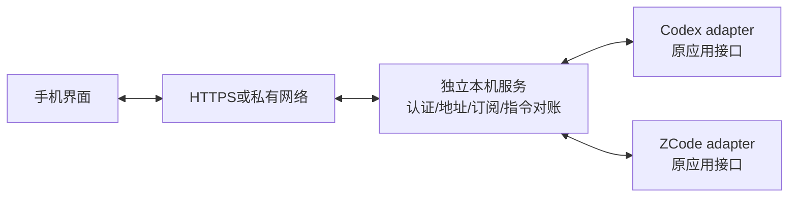

# 独立手机会话桥接规格

> **历史方案（2026-10-31）**：本文件保留此前的多 harness、窗口、传输或旧工程交付方案，不是当前发行能力或操作入口清单。当前 CodeLight 是 Codex 专用原生手机 App；其他 harness 是否启用留待后续决定。当前工程、命令和交付规则以 [产品合同](codelight-product.md)、[单独工程合同](codelight-standard-project.md) 和 [构建说明](../docs/BUILD-AND-VERIFY.md) 为准。

## 用户目标

覆盖本机已安装、正在运行的 ZCode 和 Codex，让手机实时查看并操作原桌面会话。服务独立运行，自动发现接入点，不改两款应用源码、应用包、配置，不重启、终止或恢复到第二个 Agent runtime。对现有会话只允许用户明确发起的操作；验证使用专用测试会话。

## 会话与状态权威

- native app/runtime 保持 session、活动 turn、已接受输入、工具与权限的权威。
- bridge 只持有连接、展示投影、自己的 command receipt、移动端登录与授权。
- address 必须区分 application、native session/thread id、workspace、runtime generation。
- native 控制接口可用性由当前机器实际发现和验证；读到持久化历史不等于连接到活跃 owner。
- 禁止直接写 session数据库/rollout 文件、向现有 stdio 管道强行插入、重启开启调试端口、修改运行进程或加载注入模块。
- 若平台只提供可访问性操作，必须明确展示该控制方式，按目标session和当前UI状态校验，不得向错误或未验证的session发送。

## 组成

网络与应用接入分离：私有网络可以直接访问本机服务；中继模式由本机主动出站连接，转发只处理连接与认证，不能保存第二份Agent执行队列。

## 功能合同

1. 自动发现接入状态：Codex 显示原生聊天列表；ZCode 显示真实窗口并通过原窗口任务列表浏览会话。窗口 ID 不冒充 CLI session ID。
2. 打开会话取得历史与正在进行的正文、工具、运行状态，并持续更新。
3. 对原会话发送输入；运行中输入遵循native平台的排队/引导语义。

   Codex 闲置时『发送』，已确认 foreground inProgress turn 时『补充到当前生成』复用原 steer。ZCode 的 busy 输入沿用原窗口 admission，不能按按钮文字推断 queue/steer。已确认输入后清理同地址草稿，网络不确定时保留原操作编号。
4. 停止原会话的当前生成；权限与用户问题通过原平台的响应入口处理。
5. 手机与桌面均可继续使用；手机操作不终止桌面进程、不启动第二个同session writer。
6. 重连恢复到最新权威状态，旧会话/旧代际结果不覆盖新选择。
7. 命令使用稳定id与receipt；连接中断后不得盲目重发副作用未知的命令。
8. 手机界面适配窄屏、键盘、前后台切换；没有能力的操作明确不可用，不能假装成功。
9. 访问需认证；非本机监听需显式网络授权配置。凭据不进入日志、URL或提交。
10. 可通过单一启动命令运行；启动检查自动说明缺失的系统能力，不能要求修改目标源码或重新启动目标应用。

## 验收

|要求|权威证据|
|---|---|
|ZCode原会话读写|专用真实ZCode会话中手机发送标记，桌面相同session出现；原native运行结束并显示结果|
|Codex原会话读写|同上，确认native thread与活动owner一致|
|实时输出|真实运行中的多个不同时间输出/工具状态由手机看到，而非仅最终消息|
|运行中输入/停止/交互|native平台实际处理，跨端显示一致，重复/迟到响应无第二副作用|
|不影响现有会话|前后main/runtime PID与现有session状态对照；不发送或停止现有用户会话|
|断线恢复|发送后断网、重开、切后台，正确对账和刷新，没有重复提交|
|无侵入|目标源码git状态、安装包/相关配置摘要前后相同；无新增调试进程或目标重启|
|自动启动|干净启动独立服务，能发现当前两应用，不依赖本研究聊天的MCP/工具上下文|
|手机可用|真实 iOS/Android 原生二进制、原生配对和交互验证；网络URL、认证与两adapter均验证，Web仅保留开发验证用途|

测试与报告保留真实证据，未知/不支持能力不能算通过。当前规格确定目标，不预设未验证的native接入协议。
