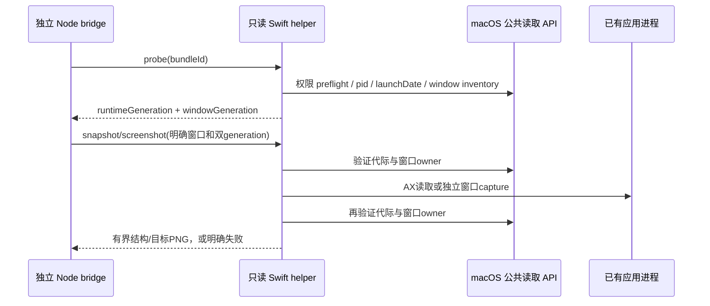

# macOS AX 只读 helper

> **延期研究（2026-10-31）**：当前 CodeLight 发行是 Codex 原生会话专用。本文件保留此前的窗口/AX 研究与验证边界，不表示当前已启用窗口共享或其他 harness。窗口 ID、截图与 AX 控件不计为 Codex session 支持；是否启用留待后续决定。当前范围以 [产品合同](codelight-product.md) 为准。

## 当前边界

2026-10-28 用户已接受 macOS 辅助功能控制。此文件中的 `macos-ax-readonly` 二进制保留只读合同；显式写操作在独立 `macos-ax-control` 二进制中实现，详见 `zcode-window-control.md`。bridge 启动/probe/subscribe 不自动激活应用或修改 AX 属性。用户手机意图或专用验证才正常启动/激活应用、开启 AXEnhancedUserInterface、点击、输入或滚动。禁止修改应用包/配置、开启 CDP、重启已运行目标或写 session DB。

Helper 是独立 Swift 命令行程序，Node 后端 spawn 后写入一行 JSON 并关闭 stdin。一次进程只处理一条请求，stdout 只输出一条 JSON response，stderr 不写用户内容。macOS 14+ 支持目标窗口截图；probe/snapshot 通过 ApplicationServices/AppKit/CoreGraphics 的公开读取 API。

## 请求与响应

通用请求字段：`id`（可选字符串）、`operation`（probe/snapshot/screenshot）、`bundleId`。未知字段或操作失败退出，响应 `{ok:false,error:{code,message},id}`。不把原生错误附带的窗口/内容文本输出到日志。

- `probe`：只查应用是否运行、权限 preflight、pid、process launch date、CoreGraphics window id/bounds/layer/onScreen 与 generation；已有 AX 权限时补充 AX 窗口 index/role/bounds，解释 CG 与 AX 几何匹配失败，index 不可作为写操作 identity。默认不读取或返回窗口 title。未运行返回 `running:false`。同 bundle 多实例需要显式 pid，否则 fail closed。
- `snapshot`：要求 `expectedRuntimeGeneration` 和 `expectedWindowGeneration`，以及 `windowId`。只读该窗口 AX 树；窗口由 CG id/owner pid 验证，再按 AX position/size 精确唯一映射，无法唯一匹配则 fail closed。默认 `includeText:false`，只返回 role/subrole/AXIdentifier/路径/bounds/可操作动作名称/可写属性标志/状态。不执行这些动作。
- `screenshot`：同样要求双 generation 和明确 `windowId`；用 ScreenCaptureKit 的 desktopIndependentWindow filter，只采集目标应用窗口，不截全桌面或其它应用。`outputDirectory` 必须是已有绝对目录，helper 用随机文件名创建 PNG，不覆盖已有文件。需已有 ScreenCapture permission；不发起授权提示。
- `pid` 可用于限定同 bundle 的某一运行实例。
- `includeText:true` 是显式内容读取：返回有界 title/description/value/placeholder；secure text 始终排除 value。每节点最多 2048 字符，总文本最多 32768 字符。当前对真实 Codex 会话只测试默认结构读取，ZCode 未运行只测试 probe。
- `maxNodes` 默认 1500，范围 1..5000；`maxDepth` 默认 18，范围 0..80（真实 Electron compositor 中空包装层可超过30层）；子节点数上限400。snapshot区分文本截断与结构截断，不能把不完整树当完整 UI；control helper使用80层但仍受5000节点上限。

成功响应含 `readOnly:true`、`permissions`、`runtimeGeneration`、窗口/快照 generation 和 `capturedAt`；截图响应只返回本地 PNG 路径/尺寸，不写文本或图片正文到日志。

## 身份与代际

- `runtimeGeneration` 是 bundleId + pid + NSRunningApplication.launchDate 的 SHA-256。launchDate 缺失时报告不能提供严格代际的错误，不能用 PID 单独替代进程身份。
- `windowGeneration` 是 runtimeGeneration + CGWindowID 的 SHA-256。操作开始/结束都验证目标仍为同一 runtime、同一 window owner。
- node identity 带窗口内 child-index path、role/subrole 和 AXIdentifier；node id 与该结构构成 SHA-256。没有唯一 AXIdentifier 的节点明确为 `structural`，不承诺跨 UI 更新稳定。
- `snapshotGeneration` 是有界树结构与状态的 SHA-256，用于以后动作前 fresh read 的一致性比较；未实现任何未来动作，snapshotGeneration 本身不构成动作授权。
- window id 不是 session id；没有原生 sessionId API 时，后续需独立验证唯一 session title/workspace/native ID 和当前 UI，禁止将 AX 目标直接视为 runtime conversation owner。

## 所有者与顺序

## 验收

1. 编译到独立 `native/bin/`，不改目标应用包或配置。
2. ZCode 未运行时 probe 返回 running:false，不启动它。
3. Codex probe/结构读取不输出 title/value/description/placeholder 正文。
4. 未实现操作（例如 press/send）被拒绝；未知字段、非法 bundle/pid/window、缺少/stale generation 失败退出。
5. screenshot 只针对已验证目标 window，能力和未执行情况如实报告。当前不对真实会话执行截图。
6. helper 源码不存在 AXUIElementPerformAction、AXUIElementSetAttributeValue、CGEventPost、activate、launchApplication、openURL 或其它动作调用。
