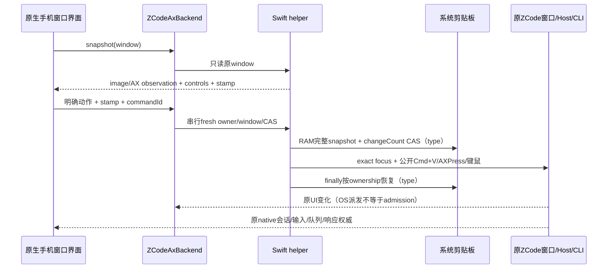

# ZCode 原窗口控制

> **延期研究（2026-10-31）**：当前 CodeLight 发行是 Codex 原生会话专用。本文件保留此前的窗口/AX 研究与验证边界，不表示当前已启用窗口共享或其他 harness。窗口 ID、截图与 AX 控件不计为 Codex session 支持；是否启用留待后续决定。当前范围以 [产品合同](codelight-product.md) 为准。

## 形态与状态所有者

手机是原生界面，ZCode 接入使用原应用窗口镜像及公开 macOS AX/键盘/鼠标控制。ZCode 没有已验证的独立session admission/subscription接口。原ZCode进程、Window Host、CLI仍是会话、输入及队列权威；bridge不启动第二runtime、不直接写原数据库、不修改原应用包/源码/provider/model配置。

窗口地址 `app-window` 或 `window_<CGWindowID>` 不是session ID；标题不能作为native ID。真实任务由原UI选择，view的kind=window、sessionIdentityVerified=false、rows/requests空、currentTurnId=null。bridge只保存自己的图像、布局stamp和操作receipt。

## 接口

| 方法 | 合同 |
| --- | --- |
| status/list | 只读installed/running/权限/窗口与代际；不启动或激活 |
| snapshot | 只读原窗口图像或AX observation，返回controls与captureStamp |
| subscribe | 引用计数轮询，清理自己的旧图像 |
| command | 串行、commandId内容摘要对账、明确原窗口动作 |
| dispose | 停止bridge读取、清理自己图像；不关原产品或取消任务 |

动作：launch、activate、enableAccessibility、press、click、type、key、scroll。payload仅runtimeGeneration/windowGeneration/captureStamp/nodeId/text/key/x/y/deltaY。正常launch仅应用未运行时复用NSWorkspace，不传调试/配置参数。enableAccessibility仅用户明确设置目标运行实例AXEnhancedUserInterface；启动和discovery不自动调用。

## 只读身份与权限

- 公开IOKit IOConsoleLocked结合CGSession console/login metadata确认锁状态。CGSession缺少锁字段不能推断锁屏/已解锁。locked或unknown时停止目标读取/控制、清除旧镜像，不尝试解锁。
- AX inventory合并AXWindows、AXMainWindow、AXFocusedWindow；读取CF opaque array。AXWindows空并不意味着Mac锁屏。原window role、owner PID、CFHash与CG ownership必须匹配。
- Stage Manager可把AX logical full window变成CG physical thumbnail。ax-only使用已绑定逻辑AXWindow hash，不伪造图像；坐标操作不可用。绑定含runtime generation，原进程变化使旧绑定失效。
- AX读取有nodes/depth/文本上限，结构截断与文本预览截断区分。实际button/input等控件label有独立2048字预算，editable value独立8000字预算，正文不会耗尽footer值。过长editable明确editableValueTruncated；不能以截断值批准Send/type。

## captureStamp 与控制CAS

stamp含runtimeGeneration、windowGeneration、layoutGeneration、imageLayoutHash、bounds、axWindowHash、axContextGeneration、axChromeGeneration、semanticTargets。nodeId是窗口结构定位，不是session identity。

| 操作 | 必需上下文 |
| --- | --- |
| 底部主composer type、底部右侧精确Send/Send now、精确Stop | 目标完整role/identity/actions/bounds/enabled/label/原值指纹 + 实际composer子树、header/sidebar CAS |
| welcome中部Send、其它AXPress、明确editable key | 完整AX上下文CAS；截断时拒绝 |
| coordinate click/key | 原图像/布局/物理bounds严格CAS，截断上下文拒绝 |
| scroll | 图像/布局/物理bounds严格CAS；正文预览截断不阻止纯滚动 |

实际composer由底部可写AXTextArea（有placeholder）和Send/Stop的共同结构祖先子树确定，header为全宽64px以内，sidebar保留左侧节点。正文AXPress容器/复制按钮属于正文。固定top10%/bottom20%会覆盖正文首尾行，不能用它们批准语义Stop/composer。窗口owner/代际/逻辑bounds始终严格验证。任务标题、侧栏、editor、模式/model/Send或Stop变化仍拒绝。权限/问题卡片保持完整上下文，不借Stop规则批准。

明确activate只正常Raise/激活已验证原窗口。提供captureStamp时，先按stamp中的AX hash唯一解析同PID、AXWindow role和原逻辑bounds，并校验原runtime/window generation；完成绑定之后才执行一次正常activate/Raise。Stage Manager缩略窗的CG physical bounds不能用于替代已捕获的AX逻辑身份，也不能在已经激活之后再用旧缩略窗尺寸查找AXWindow。未提供AX身份时只允许原有唯一CG/AX物理匹配，匹配失败必须在副作用之前拒绝，不能fallback到main window。

激活后仅只读观测相同PID/runtime/CG window ID/AX对象、精确focused window、frontmost app及该CG窗口与AX逻辑几何一致才确认呈现；1.5秒内未确认按unknown，不按延时猜成功、不盲目重复。windowGeneration只由runtime与CG window ID生成；激活呈现变化不改变其身份，也不允许跳到另一CG ID。确认结果要求fresh mirror，不能沿用旧physical图像或布局stamp。坐标换算至原窗口屏幕bounds，派发前确认verified app/window焦点。

## 唯一文本机制

`type`仅标准系统Cmd+V一次，不叠加AXValue setter/Unicode字符event。先确认原PID/window/精确editable，要求实际空草稿；正常Raise/activate并确认精确AXFocusedWindow/AXFocusedUIElement。粘贴前再次核对owner/代际/锁屏/focus/空草稿，粘贴后仅只读等待完整editor value，最多1.5秒。未确认、部分文本、焦点丢失或目标变化返回delivery-unknown，不重试、不追加、不隐式Send、不自动删除已有草稿。

`key`可明确指定editable nodeId并用完整上下文校验/精确focus；支持enter/escape/tab/shift-enter/command-enter/command-a/backspace/command-n/up/down/left/right。明确Cmd+A/backspace属于用户编辑，不由type自动执行。键盘/鼠标使用公开session event tap，不把postToPid派发当作真实交互。

## 临时剪贴板事务（已授权）

- 完整多item、各item所有advertised type及完整Data只保存在RAM，保留顺序/空数据。legacy无items时按board types完整读取单item；多item以item真实representations为准，board兼容alias不能误判为数据缺失。
- 最多64 items、128 types/item、总16MiB；nil data、超限、读取期间changeCount或type集合变化，拒绝输入且不修改clipboard。
- 写入前changeCount CAS；本次clearContents返回值是ownership token，不采纳后续最新changeCount冒充ownership。写完整plain text；Cmd+V前确认token与精确focus。
- finally在成功/异常路径恢复完整snapshot，只有当前changeCount等于本事务token才恢复；用户后来复制则skip，空clipboard恢复为空。结果仅restored/skipped-concurrent-change/failed/unchanged，不记录clipboard内容、type、原bytes，不落盘。
- clipboard临时被输入占用是实际效果，手机须说明。restore失败或输入结果未知均不自动重放。

## 新鲜度与receipt

Stage Manager后台AX cache可在原CLI已完成/取消后暂显示旧Stop或草稿。ax-only返回contentFreshness=ax-observation-only、presentationVerified=false；不能当成live runtime状态/业务完成。明确activate后fresh capture刷新呈现。full image返回captured-window-image。只读重连不自动激活。

performed只证明OS动作派发。admission/取消/完成必须原native evidence，不把点击当模型成功。稳定commandId至多派发一次，内容冲突拒绝；未知效果保持delivery-unknown，断线不自动重发。持久化receipt与手机人工核对由rootserver/client负责。

native helper错误可在receipt保留可选nativeCause，仅允许80字符以内的小写字母、数字、下划线和连字符错误码；不保存原始错误文本、AX内容、路径或凭据。nativeCause不能将unknown改成failed/complete，也不能授权重发。旧未保存cause的unknown保持未知，不猜补历史cause。

## 已验证边界

历史验收在应用重启后重新发现进程与窗口代际，未沿用旧 capture 身份。具体进程、窗口和会话标识只保留在本机私有证据中。

- 自有部分草稿精确匹配→标准Cmd+A/backspace真实清空→Send disabled。
- 完整两行中文/emoji→显式Send前DB无输入→原生Send/admission/assistant精确echo。
- 原生Stop取消model stream：model_request_cancelled、turnResult=cancelled；前面自然完成样本不算Stop。
- 同专用session停止后恢复；busy输入admittedAt比前一assistant completedAt早2007ms，delivery=queue，随后promoted/drained并完成BUSYACK。
- 对原专用测试会话只读对账；既有 provider/model/effort 保持不变，无 tool parts。
- 21原生CAS/clipboard/text-budget gates、12只读schema、8control schema、7backend UT，实际结果见verification-status.md。
- 权限/问题工具未触发，不能标为实测通过。手机端整体iOS/Android验收由root继续。
